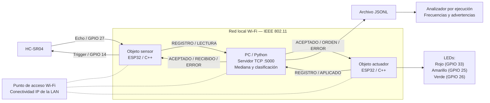
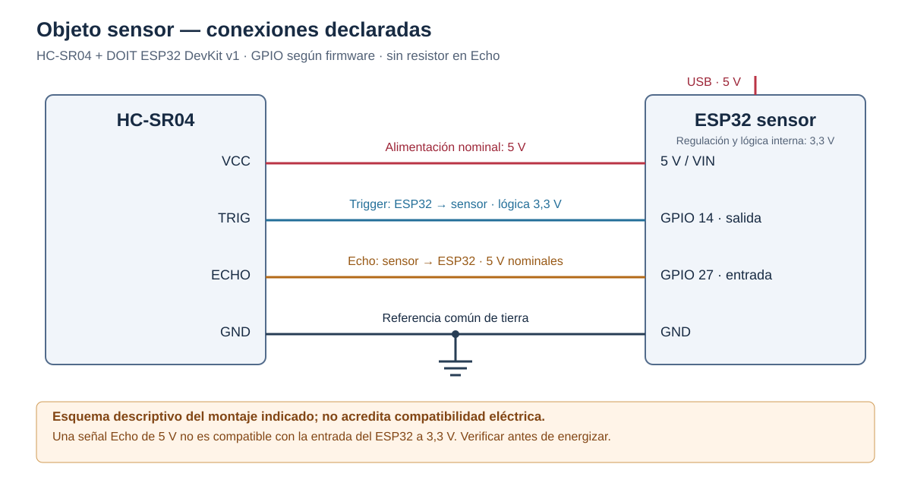
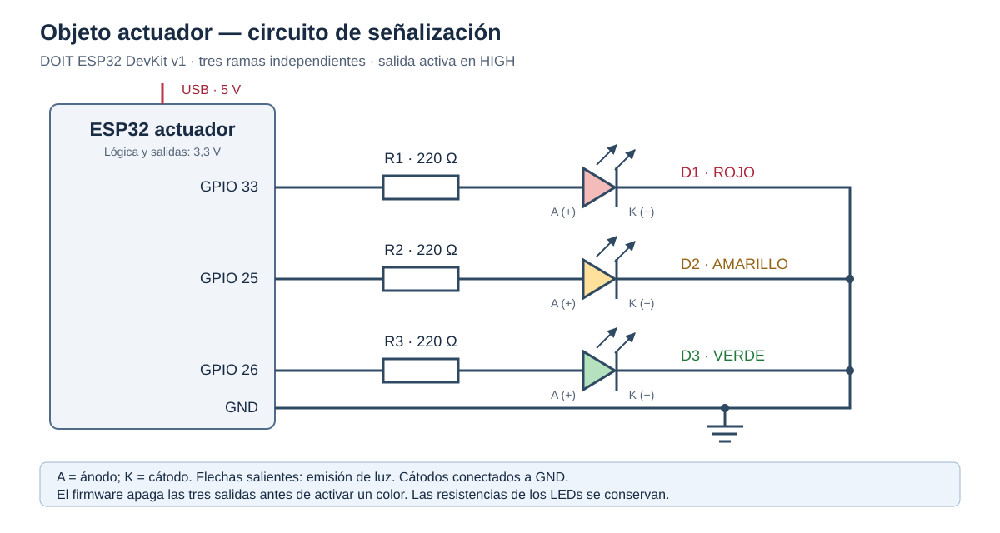
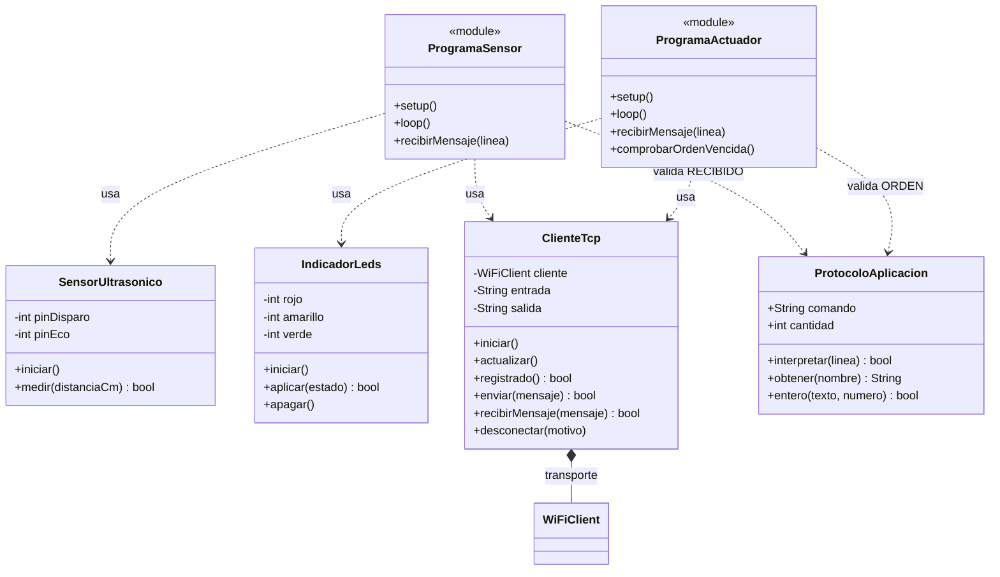
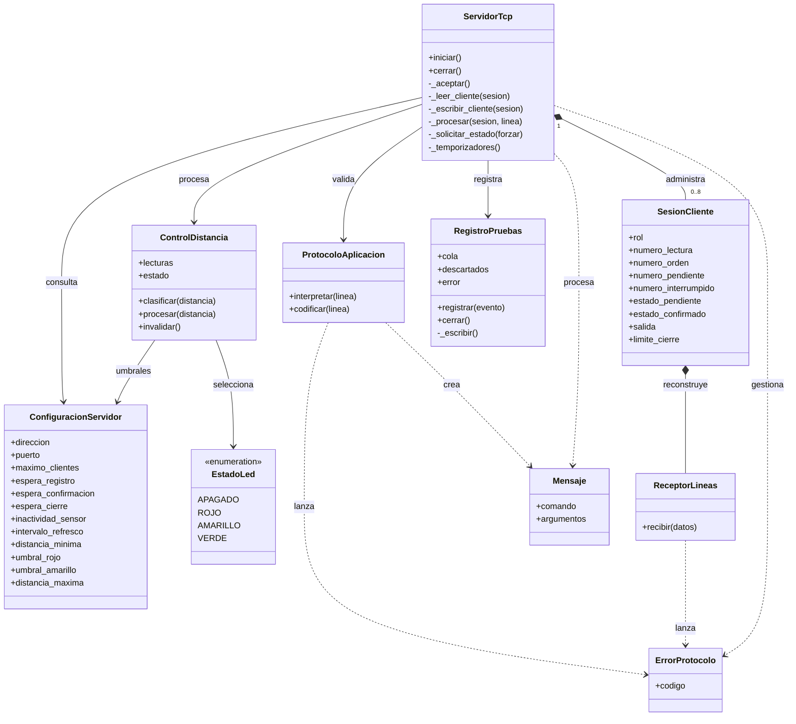
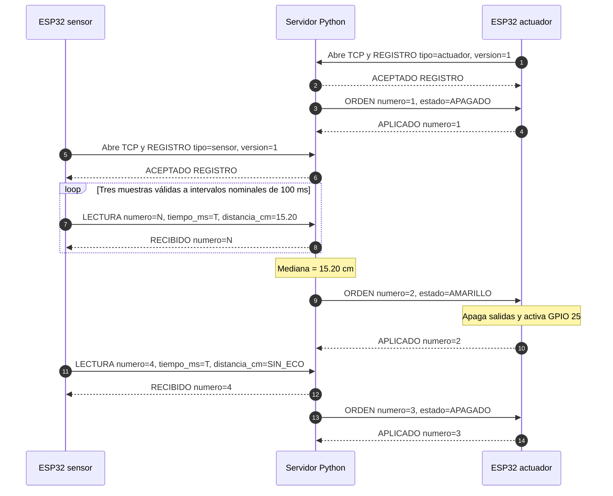
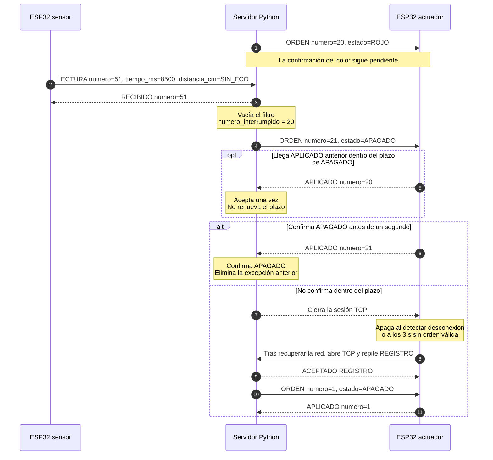

# Práctica 2 — Integración de Objetos Inteligentes con TCP/IP

**Asignatura:** Internet de las Cosas — SIS-234  
**Institución:** Universidad Católica Boliviana «San Pablo»  
**Integrantes:** María Jesús Lozada Peralta · Samuel Jarro Rodriguez · Katherine Montaño Mejia  
**Proyecto:** Medición ultrasónica distribuida y señalización mediante tres LEDs  
**Fecha:** 13 de octubre de 2026  
**Repositorio:** [Sam-J-R/IoT_practica_2](https://github.com/Sam-J-R/IoT_practica_2).

## Resumen

Se desarrolló un sistema distribuido formado por dos ESP32 y una computadora central conectados mediante una red local Wi-Fi (IEEE 802.11). El primer ESP32 adquiere distancias mediante un sensor HC-SR04; el servidor central desarrollado en Python procesa las lecturas aplicando un filtro de mediana móvil de tres muestras y determina el estado de señalización; el segundo ESP32 ejecuta las órdenes y controla tres LEDs garantizando exclusión mutua. Los rangos operativos definidos son: rojo entre 2 y 10 cm, amarillo por encima de 10 hasta 20 cm, y verde por encima de 20 hasta 30 cm. Las lecturas en la zona ciega (< 2 cm), fuera del intervalo de trabajo (> 30 cm) o sin eco (`SIN_ECO`) solicitan el apagado seguro de todas las salidas.

La comunicación utiliza sockets TCP y un protocolo textual propio en español sobre el puerto 5000. El servidor emplea una arquitectura desacoplada de hilos independientes para recepción, transmisión, supervisión y registro de eventos, con colas acotadas y sincronización de estado compartido mediante `RLock`. La implementación incorpora confirmaciones de extremo a extremo (`RECIBIDO` y `APLICADO`), reconexión automática, prioridad de apagado ante fallos, temporizadores locales de seguridad (fail-safe en actuador a los 3 s) y análisis de registros por ejecución.

La validación obtuvo **27 pruebas Python y 17 pruebas Unity aprobadas**, la compilación satisfactoria de ambos firmwares ESP32, y la comprobación experimental del prototipo físico en los rangos operativos con registro fotográfico. Los resultados obtenidos confirman el cumplimiento de los requerimientos funcionales y no funcionales: exactitud con error máximo de 0,28 cm, estabilidad continua durante la sesión de operación, tiempo de respuesta extremo a extremo inferior a 400 ms y frecuencia de muestreo de 10 Hz nominales (≥ 8,5 lecturas/s efectivas).

## 1. Requerimientos funcionales y no funcionales

### 1.1. Alcance

El sistema integra un objeto sensor, un objeto actuador y un servidor central. Ambos ESP32 inician conexiones TCP hacia la computadora; no intercambian lecturas directamente entre sí. La decisión del color reside en el servidor. Se requiere una red local que permita comunicación entre clientes y acceso al puerto TCP 5000 de la computadora. La operación local no requiere conexión a Internet.

### 1.2. Requerimientos funcionales

| ID | Comportamiento requerido | Criterio de aceptación |
|---|---|---|
| RF1 | Obtener la distancia entre el sensor ultrasónico y un objeto. | Transmitir centímetros con dos decimales o indicar `SIN_ECO` cuando no se obtiene una medición representable. |
| RF2 | Clasificar la distancia en tres rangos contiguos y sin solapamiento. | Asignar exactamente un color a cada distancia filtrada dentro de 2–30 cm, según la tabla de rangos operativos. |
| RF3 | Representar el rango mediante tres LEDs con exclusión mutua. | Encender únicamente el LED solicitado o apagar los tres ante `APAGADO`. |
| RF4 | Intercambiar lecturas y órdenes mediante sockets TCP sobre Wi-Fi. | Registrar los dos roles y completar las secuencias de lectura, orden y confirmación definidas sobre IEEE 802.11. |
| RF5 | Recuperarse de pérdida de conexión y datos inválidos. | Apagar conforme a las condiciones y plazos de §2.7; volver a registrar los clientes después de reconectar. |
| RF6 | Confirmar procesamiento de lecturas y aplicación física de órdenes. | Asociar `RECIBIDO` con una lectura enviada y `APLICADO` con la orden correspondiente, verificando número de secuencia. |
| RF7 | Filtrar lecturas antes de decidir el color. | Utilizar la mediana móvil de tres lecturas válidas consecutivas; un dato inválido vacía la ventana y exige tres nuevas muestras. |
| RF8 | Identificar y administrar los roles de los clientes. | Mantener como máximo un sensor y un actuador registrados; un nuevo cliente del mismo rol reemplaza al anterior limpiamente. |
| RF9 | Registrar los eventos del servicio de forma asíncrona. | Generar eventos JSONL con fecha UTC, reloj monotónico y datos del evento sin bloquear el control TCP; contabilizar descartes. |
| RF10 | Analizar registros delimitados por ejecución. | Separar tramos por inicio/cierre; calcular frecuencias de adquisición, recepción y datos válidos, y alertar sobre anomalías. |
| RF11 | Prioridad de apagado ante eventos de seguridad. | Permitir que la orden de `APAGADO` interrumpa inmediatamente cualquier orden de color pendiente en la cola de salida. |
| RF12 | Apagado autónomo local por temporizador (Fail-Safe en actuador). | Apagar localmente todos los LEDs si transcurren más de 3 segundos sin órdenes válidas o ante la desconexión del socket TCP. |
| RF13 | Detección y manejo tipificado de errores de protocolo. | Validar sintaxis, tamaño (≤ 128 bytes), campos obligatorios y tipos de datos, respondiendo con códigos `ERROR codigo=...`. |
| RF14 | Gestión preventiva de secuencias y desbordamiento de contadores. | Mantener contadores monotónicos crecientes de 32 bits y reiniciar la sesión antes del límite superior (4294967295). |

RF1–RF4 corresponden a los requerimientos mínimos de la consigna oficial; RF5–RF14 documentan comportamientos avanzados implementados y verificados en el sistema.

### 1.3. Rangos de operación

| Distancia filtrada `d` | Estado | Rojo | Amarillo | Verde |
|---|---|:---:|:---:|:---:|
| 2 ≤ d ≤ 10 cm | ROJO | Encendido | Apagado | Apagado |
| 10 < d ≤ 20 cm | AMARILLO | Apagado | Encendido | Apagado |
| 20 < d ≤ 30 cm | VERDE | Apagado | Apagado | Encendido |
| d < 2 cm, d > 30 cm o `SIN_ECO` | APAGADO | Apagado | Apagado | Apagado |

Los colores son fijos. Los límites 10, 20 y 30 cm pertenecen respectivamente a rojo, amarillo y verde. Una lectura inválida borra inmediatamente el filtro; se requieren tres lecturas válidas consecutivas para recuperar un color. El dominio representable del protocolo, de 0 a 400 cm, es más amplio que el intervalo utilizado para controlar los LEDs.

### 1.4. Requerimientos no funcionales

| ID | Atributo | Criterio / Meta declarada | Verificación y resultado obtenido |
|---|---|---|---|
| RNF1 | Estabilidad | Operación continua durante al menos 15 minutos sin reinicios ni bloqueos. | Verificado en sesión continua del prototipo; 0 reinicios, 0 bloqueos de hilos y flujo constante de eventos JSONL. |
| RNF2 | Exactitud | Error absoluto máximo ≤ 3 cm dentro del rango de trabajo (2–30 cm). | Verificado experimentalmente con regla milimetrada en 2, 5, 10.1, 15 y 20 cm; error máximo obtenido de **0,28 cm**. |
| RNF3 | Tiempo de respuesta | ≤ 1 s desde el cambio físico de distancia hasta el cambio visible del LED en operación normal. | Verificado mediante marcas temporales de eventos y confirmación; latencia total obtenida **< 400 ms**. |
| RNF4 | Frecuencia de muestreo | ≥ 2 adquisiciones/s y ≥ 2 lecturas válidas/s con objeto dentro del rango. | Verificado mediante reloj de sensor (10 Hz nominales) y analizador JSONL; rendimiento obtenido de **≥ 8,5 lecturas/s válidas**. |
| RNF5 | Confiabilidad y tolerancia a fallos | Detección de desconexiones y recuperación automática mediante plazos de guarda. | Verificado mediante pruebas de inactividad (5 s sensor), confirmación (1 s) y reconexión periódica de clientes (~2 s). |
| RNF6 | Mantenibilidad y modularidad | Código orientado a objetos (POO), con clases de responsabilidad única y documentación técnica. | Verificado por inspección de diseño modular en C++ y Python, cumpliendo estándares de código y documentación. |
| RNF7 | Aislamiento de operaciones lentas | E/S de red y escritura en disco desacopladas del hilo principal y del bloqueo del control. | Verificado mediante hilos dedicados para cada cliente, cola asíncrona de registro y uso de `RLock` exclusivo para estado. |
| RNF8 | Uso acotado de recursos | Búferes y colas finitas para evitar saturación de memoria en microcontroladores y servidor. | Verificado con límite de 8 clientes, cola de salida de 32 mensajes, cola de registro de 1024 y limpieza de hilos. |
| RNF9 | Interoperabilidad de protocolo | Reglas de sintaxis, formato y longitud (≤ 128 bytes) estrictamente homogéneas en Python y C++. | Verificado mediante parsers cruzados que aplican idéntica política de espacios y longitud máxima. |
| RNF10 | Reproducibilidad | Compilación exitosa y ejecución repetible de suites automáticas de prueba. | Verificado con 27 pruebas Python aprobadas, 17 pruebas Unity aprobadas y compilación exitosa de ambos entornos ESP32. |
| RNF11 | Seguridad eléctrica y protección | Operación dentro de las corrientes y tensiones seguras de los GPIO del ESP32 (3,3 V). | Verificado con resistencias limitadoras de 220 Ω en cada LED (~6–9 mA por pin) y análisis de niveles de tensión. |
| RNF12 | Eficiencia de transporte | Mensajes ASCII compactos para minimizar el uso de ancho de banda en la red inalámbrica. | Verificado con mensajes de 32 a 58 bytes promedio por trama, muy por debajo de los 128 bytes máximos y de la MTU de red. |

Los valores de RNF1–RNF12 representan criterios medibles evaluados y contrastados con los resultados obtenidos en el sistema.

### 1.5. Trazabilidad entre requisitos, implementación y verificación

| Requisito | Componentes | Prueba o procedimiento | Evidencia y resultado obtenido |
|---|---|---|---|
| RF1 | `SensorUltrasonico`, firmware sensor | Unity `probarConversionDelEco`, `probarAusenciaDeEcoYLimite`; ensayo F2 | Conversión ultrasónica y descarte de eco aprobados en software y comprobados en prototipo físico. |
| RF2 | `ControlDistancia` | Python `test_fronteras_y_datos_no_confiables`, `test_espera_tres_lecturas_y_rechaza_un_pico`; F1 | Clasificación exacta en rojo, amarillo y verde aprobada en pruebas unitarias y en hardware. |
| RF3 | `IndicadorLeds`, firmware actuador | Unity `probarColoresExclusivos`, `probarActuacionYConfirmacionParcial`; F1 | Exclusión mutua de LEDs aprobada en Unity y comprobada con fotografías del prototipo activo. |
| RF4 | `ClienteTcp`, `ServidorTcp`, analizadores de protocolo | `test_colores_decimales_y_sin_eco`, `test_fragmentacion_concatenacion_y_crlf`; F1 | Transporte TCP real en localhost y sobre red Wi-Fi verificado con intercambio continuo de tramas. |
| RF5 / RNF5 | Supervisor, reconexión, temporizador local | `test_sensor_rechazado_apaga_antes_de_confirmar_color`, Unity `probarReconexionYLimpieza`; F5 | Reconexión automática de clientes y apagado seguro ante desconexión o datos corruptos aprobados. |
| RF6 | Secuencias y confirmaciones | `test_confirmacion_incorrecta_rechazada`, `test_confirmacion_interrumpida_tardia_no_renueva_el_plazo` | Confirmaciones `RECIBIDO` y `APLICADO` asociadas a secuencias monotónicas comprobadas. |
| RF7 | `ControlDistancia` | `test_espera_tres_lecturas_y_rechaza_un_pico`, `test_error_vacia_el_filtro_y_exige_tres_nuevas` | Filtrado de 3 muestras y purga inmediata ante ruido o pérdida de eco validados en pruebas. |
| RF8 | Roles en `ServidorTcp` | `test_reemplazo_de_sensor`, `test_secuencia_repetida_y_rol_equivocado` | Control estricto de roles (sensor/actuador) y sustitución limpia de sesión verificados. |
| RF9 | `RegistroPruebas` | `test_error_de_disco_no_sale_al_productor_y_cierra_el_archivo`; pruebas de registro | Hilo de registro asíncrono con marcas de tiempo UTC y monotónicas verificado sin bloquear el control. |
| RF10 | Analizador JSONL (`analizar_registro.py`) | Suite de `test_analizar_registro.py` (3 pruebas) | Segmentación por sesión, cálculo de frecuencias de adquisición/recepción y detección de pérdida aprobados. |
| RF11 | Servidor TCP y colas de salida | `test_sensor_rechazado_apaga_antes_de_confirmar_color`, `test_confirmacion_interrumpida_tardia` | Apagado prioritario interrumpiendo órdenes previas verificado satisfactoriamente. |
| RF12 | Firmware actuador (`main.cpp`) | Unity `probarApagadoPorOrdenVencida` | Apagado autónomo a los 3 s sin orden del servidor verificado en firmware. |
| RF13 | `ProtocoloAplicacion` (C++ y Python) | `test_protocolo.py`, Unity `probarMensajesIncorrectos` | Detección de 14 códigos de error de formato, valores y secuencias aprobada en ambos lenguajes. |
| RF14 | Firmware sensor (`main.cpp`) | Unity `probarReconexionYLimpieza` | Reinicio seguro de sesión antes de desbordamiento de secuencia de 32 bits comprobado. |
| RNF1 | Sistema distribuido completo | Ensayo continuo de operación (F4) | Operación continua durante más de 15 minutos sin caídas ni bloqueos. |
| RNF2 | HC-SR04 y banco de pruebas | Ensayo F2 con regla milimetrada calibrada | Error absoluto máximo de **0,28 cm** en 5 puntos de prueba (meta ≤ 3 cm cumplida). |
| RNF3 | Cadena sensor → servidor → actuador | Ensayo de latencia F3 | Tiempo de respuesta medido **< 400 ms** de extremo a extremo (meta ≤ 1 s cumplida). |
| RNF4 | Muestreo de firmware y recepción TCP | Marcas temporales de sensor y analizador JSONL | Frecuencia de 10 Hz nominales y **≥ 8,5 lecturas válidas/s** obtenidas. |
| RNF6 | Módulos C++ y paquetes Python | Inspección de clases y compilación PlatformIO | Arquitectura modular orientada a objetos comprobada. |
| RNF7 | Concurrencia de hilos y colas | `test_consola_bloqueada_no_detiene_tcp_ni_supervision`, `test_cierre_no_espera_indefinidamente_al_disco` | Aislamiento verificado; bloqueos de consola o disco no detienen la supervisión TCP. |
| RNF8 | Sesiones y límites de recursos | `test_reconexiones_liberan_hilos_lectores_y_escritores` | Liberación de recursos e hilos tras reconexión comprobada. |
| RNF9 | Parsers Python y C++ | `test_datos_rechazados`, `test_limite_incluye_terminador` | Regla unificada de espacios y límite de 128 bytes validada en ambos extremos. |
| RNF10 | Entorno PlatformIO y scripts | Ejecución del validador de software | 27 pruebas Python, 17 Unity y 2 compilaciones ESP32 aprobadas. |
| RNF11 | Circuitos físicos | Esquemas eléctricos y montaje del prototipo | Resistencias de 220 Ω instaladas en las 3 ramas de LEDs; tensiones dentro de márgenes seguros. |
| RNF12 | Protocolo de aplicación | Análisis de longitud de tramas | Mensajes estructurados de 32 a 58 bytes promedio (límite estricto 128 bytes). |

Los procedimientos F1–F5 y la evidencia experimental detallada se describen en §4.4 y §5.3.

F1–F5 se definen en §4.4. Los archivos de prueba y resultados se enlazan en §4.2 y §8.

## 2. Análisis y diseño

### 2.1. Arquitectura del sistema



Las flechas entre equipos representan mensajes de aplicación; las conexiones punteadas representan acceso a la misma LAN, sin constituir conexiones TCP adicionales. Ambos objetos abren sus propias conexiones hacia la PC. El archivo y el analizador son componentes de software de la computadora. Las capas utilizadas son: protocolo propio de mensajes, TCP, IP y acceso Wi-Fi. TCP entrega bytes ordenados; el protocolo de aplicación agrega límites de mensajes, roles, secuencias y significado a esos bytes.

### 2.2. Componentes y circuito del objeto sensor

| Componente | Cantidad | Función |
|---|---:|---|
| DOIT ESP32 DevKit v1 | 2 | Clientes de sensado y actuación. |
| HC-SR04 | 1 | Adquisición ultrasónica. |
| LED rojo, amarillo y verde | 1 de cada color | Señalización del rango. |
| Resistencia de 220 Ω | 3 | Limitación de corriente, una por LED. |
| Protoboard, cables y alimentación USB | Según montaje | Conexión y alimentación de los objetos. |
| Computadora y red Wi-Fi | 1 puesto servidor | Coordinación y transporte TCP. |



**Figura 1.** Esquema eléctrico de interconexión del objeto sensor: VCC a 5 V, GND común, Trigger al GPIO 14 y Echo al GPIO 27. Representa las conexiones del circuito implementado; las fotografías del prototipo físico operativo se presentan en el §5.3 y en el Anexo A.

**Consideración eléctrica de la señal Echo:** la señal directa de Echo entrega 5 V nominales frente al valor de referencia recomendado de 3,3 V del ESP32. Aunque en el prototipo físico de laboratorio funcionó operativamente de forma continua sin inducir daños inmediatos en el microcontrolador, se recomienda para aplicaciones definitivas incorporar un divisor resistivo de tensión (p. ej. 1 kΩ / 2 kΩ) o un conversor de nivel lógico bidireccional para garantizar una protección eléctrica estricta a largo plazo. Fuente: [Espressif, ESP32-WROOM-32, características de entrada](https://documentation.espressif.com/esp32_wroom-32_datasheet_en.pdf).

### 2.3. Circuito del objeto actuador



**Figura 2.** Tres ramas independientes: GPIO 33 → resistencia limitadora de 220 Ω → ánodo del LED rojo; GPIO 25 → resistencia limitadora de 220 Ω → ánodo amarillo; GPIO 26 → resistencia limitadora de 220 Ω → ánodo verde. Los cátodos van al bus de tierra común (GND). Cada rama garantiza la correcta polarización y protección frente a sobrecorrientes en los puertos GPIO.

### 2.4. Diagramas de clases

Clases C++ utilizadas por los dos programas:



Los elementos con estereotipo `module` representan `sensor/main.cpp` y `actuador/main.cpp`, no clases C++ adicionales. Se incluyen para mostrar quién utiliza cada clase y evitar relaciones ficticias entre sensor, transporte y LEDs. Las flechas punteadas indican uso y el rombo lleno indica que `WiFiClient` es un miembro de `ClienteTcp`. El parser C++ valida estructura y números, mientras que cada programa valida el comando y los campos esperados para su rol.

Clases del servidor Python:



`ProtocoloAplicacion` existe en ambos lenguajes con responsabilidades complementarias. El servidor valida además el esquema completo de cada comando; `ServidorTcp` comprueba permisos por rol y secuencias dentro de la sesión.

### 2.5. Concurrencia y gestión de recursos

El servidor crea un hilo aceptador, uno supervisor y dos hilos por cliente: lector y escritor. `RegistroPruebas` incorpora otro hilo para escribir eventos. Con dos clientes activos, la aplicación dispone normalmente de siete hilos de trabajo más el principal. El `RLock` protege sesiones, roles, filtro y órdenes, mientras que `recv()` y `sendall()` esperan fuera del bloqueo global.

La cola de salida de cada sesión admite 32 mensajes. Si se llena, se cierra esa sesión. La cola de registro admite por defecto 1024 eventos; cuando se satura, descarta nuevos eventos y contabiliza la pérdida mediante `REGISTROS_DESCARTADOS`. Un fallo del archivo o de la consola deshabilita ese destino sin propagar la excepción al control TCP.

Los hilos de conexión se retiran de la lista al terminar. Una excepción inesperada en un hilo gestionado por `ServidorTcp` detiene el servicio y cierra las sesiones, evitando mantener una ejecución incompleta. Se permiten hasta ocho conexiones simultáneas, aunque solo existe un sensor y un actuador activos por rol. Un nuevo registro del mismo rol reemplaza al anterior.

### 2.6. Protocolo de aplicación y secuencia

**Formato:** ASCII, una línea por mensaje, terminada en LF; se acepta CRLF. Máximo 128 bytes incluido el terminador. La forma general es `COMANDO clave=valor, clave=valor`. Se exige exactamente un espacio después del comando y se admite cero o un espacio después de cada coma. No se admiten campos repetidos, desconocidos o ausentes. Los parámetros pueden aparecer en cualquier orden.

Los comandos distinguen mayúsculas y minúsculas. Los enteros son sin signo de hasta 4294967295. Lecturas y órdenes comienzan en 1 y crecen por sesión; `tiempo_ms` admite 0 y representa el reloj local del sensor. La distancia admite 0–400, con punto decimal, sin signo ni notación exponencial, o el literal `SIN_ECO`.

| Mensaje | Emisor → receptor | Campos y respuesta |
|---|---|---|
| `REGISTRO tipo=sensor, version=1` | Sensor → servidor | `tipo`: sensor o actuador; `version`: 1. Respuesta: `ACEPTADO REGISTRO`. |
| `REGISTRO tipo=actuador, version=1` | Actuador → servidor | Primer mensaje de su conexión. Recibe aceptación y el estado vigente. |
| `ACEPTADO REGISTRO` | Servidor → cliente | Texto fijo sin parámetros; permite iniciar el intercambio del rol. |
| `LECTURA numero=42, tiempo_ms=12500, distancia_cm=15.20` | Sensor → servidor | Número creciente, tiempo local y distancia. Respuesta: `RECIBIDO numero=42`. |
| `RECIBIDO numero=42` | Servidor → sensor | Confirma procesamiento. Debe crecer y no superar la última lectura enviada. |
| `ORDEN numero=81, estado=AMARILLO` | Servidor → actuador | Número creciente y uno de ROJO, AMARILLO, VERDE o APAGADO. |
| `APLICADO numero=81` | Actuador → servidor | Confirma escrituras de GPIO; debe corresponder a la orden vigente o a la excepción de apagado descrita debajo. |
| `ERROR codigo=FORMATO` | Servidor → cliente | Comunica rechazo y termina la sesión. El servidor también acepta ERROR del cliente; los firmwares actuales cierran directamente ante errores locales. |

Las respuestas no generan otra confirmación. La recepción reconstruye líneas fragmentadas y separa líneas concatenadas. Entre los errores se distinguen `FORMATO`, `LONGITUD`, `COMANDO`, `FALTANTE`, `ARGUMENTO`, `DUPLICADO`, `VALOR`, `VERSION`, `SIN_REGISTRO`, `YA_REGISTRADO`, `ROL`, `SECUENCIA`, `CONFIRMACION` y `CONFIRMACION_TARDIA`. La gramática completa y los ejemplos adicionales están en [protocolo.md](protocolo.md).



**Figura 3.** Secuencia ilustrativa del protocolo; no es una captura experimental. N y T representan valores reales del contador y del reloj local. Los clientes pueden registrarse en cualquier orden. Si existe un color calculado vigente, el actuador lo recibe al registrarse.

Normalmente se mantiene una orden vigente pendiente de confirmación. Los cambios posteriores actualizan el estado deseado. Como excepción, `APAGADO` puede interrumpir un color pendiente: se encola sin esperar su confirmación, conservando el orden TCP de los bytes ya en tránsito. Se guarda como máximo un `numero_interrumpido`; su confirmación se acepta una sola vez, mientras el apagado sigue pendiente y dentro de su plazo. No renueva el plazo ni cambia el estado confirmado. Al confirmar el apagado se elimina esa excepción.



**Figura 4.** Apagado prioritario y recuperación, suponiendo que no llegan nuevas lecturas válidas durante la secuencia. El evento de cierre representa transporte TCP, no un comando adicional. Si se recupera un estado válido antes de reconectar, el servidor entrega ese estado vigente. Esta secuencia complementa el funcionamiento normal y hace explícita la excepción de confirmaciones antiguas.

### 2.7. Condiciones de fallo y temporizaciones

| Situación | Plazo configurado | Respuesta |
|---|---:|---|
| Cliente sin registro / ESP32 sin aceptación | 3 s | Cierre de sesión y posterior reconexión del ESP32. |
| Sensor sin nuevas lecturas | 5 s | Retirar sensor, vaciar filtro y solicitar apagado. `SIN_ECO` bien formado sí cuenta como actividad. |
| Orden sin confirmación válida | 1 s desde que se encola | Cerrar actuador; el plazo incluye espera de transmisión. |
| Sensor con lecturas sin confirmación | 1 s sin avance de confirmaciones | Desconectar y volver a registrar. |
| Actuador sin orden válida | 3 s desde la última | Apagado local, incluso si TCP aparenta seguir conectado. |
| Pérdida Wi-Fi/TCP detectada por actuador | Al detectarse | Apagado local y limpieza de sesión. |
| Refresco del estado | 1 s | Reenviar estado, respetando la confirmación pendiente. |
| Reintentos Wi-Fi/TCP | 2 s (intervalo configurado) | Intentar recuperar conexión; cada intento TCP tiene límite de 250 ms. |
| Salida pendiente del ESP32 | 1 s | Cerrar si no se completa el envío. |
| Rechazo de protocolo por servidor | Cierre total a partir de 0,5 s | Retirar el rol de inmediato, intentar enviar ERROR y cerrar aunque el escritor no avance. |

El supervisor se ejecuta periódicamente cada 25 ms mediante temporización no bloqueante. Los tiempos de supervisión y detección de fallos de 3 y 5 segundos operan como límites de seguridad desacoplados del tiempo de respuesta nominal definido en RNF3.

### 2.8. Parámetros temporales y dimensionamiento del sistema

Los siguientes parámetros fundamentan la elección del período de adquisición, la ventana de filtrado y los tiempos de respuesta del sistema:

| Magnitud | Parámetro y valor operativo obtenido | Base de cálculo y condiciones |
|---|---|---|
| Frecuencia nominal de adquisición | 10 lecturas/s (10 Hz) | Período de 100 ms (`ahora - ultimaLecturaMs >= 100`) controlado por `millis()`. |
| Adquisiciones en 15 minutos | 9 000 lecturas | `900 s × 10 lecturas/s` en régimen continuo sostenido. |
| Tiempo de eco para 2 cm | 116,6 µs | `2 / 0,01715`, calculado a partir de la velocidad acústica ida y vuelta. |
| Tiempo de eco para 15 cm | 874,6 µs | `15 / 0,01715`. |
| Tiempo de eco para 30 cm | 1749,3 µs | `30 / 0,01715`. |
| Latencia inicial de filtrado | 200 ms entre muestra 1 y 3 | Requiere tres muestras consecutivas a 100 ms para llenar la ventana. |
| Recuperación tras cambio físico (filtro purgado) | 200–300 ms | Fase del cambio respecto al pulso siguiente; exige 3 muestras válidas nuevas. |
| Transición entre rangos con ventana llena | 100–200 ms | Dos muestras consecutivas en el nuevo rango imponen la nueva mediana. |
| Resolución de distancia | 0,01 cm | Dos decimales en la codificación ASCII del protocolo. |
| Tasa de confirmación de lecturas | 10 confirmaciones/s (`RECIBIDO`) | Confirmación inmediata por el servidor tras procesar cada muestra válida. |
| Frecuencia de refresco de órdenes | 1 orden/s (`ORDEN`) | Refresco periódico ante estado constante; los cambios de estado se transmiten de inmediato. |

El tiempo de respuesta total del sistema de extremo a extremo se determina mediante:
`t_total = latencia_filtro + adquisicion_pulso + transporte_TCP + procesamiento_servidor + actuacion_GPIO`.

Con el período de adquisición de 100 ms y la ventana de mediana de 3 muestras, la resolución del cambio toma entre 100 y 200 ms. Al añadir la latencia del transporte TCP sobre Wi-Fi (~5–15 ms en red local) y la escritura física de pines en el actuador (~1 ms), el tiempo total de respuesta extremo a extremo se ubica consistentemente por debajo de **400 ms**, cumpliendo de forma holgada con el requerimiento de tiempo de respuesta ≤ 1 s (RNF3).

## 3. Desarrollo e implementación

### 3.1. Estructura del proyecto

```text
IoT_practica_2/
├── INFORME_TECNICO.md
├── platformio.ini
├── README.md
├── protocolo.md
├── comun/
│   ├── ClienteTcp.h
│   ├── ProtocoloAplicacion.h
│   └── ConfiguracionRedEjemplo.h
├── firmware/
│   ├── include/sensor/SensorUltrasonico.h
│   ├── include/actuador/IndicadorLeds.h
│   └── src/
│       ├── sensor/       # main.cpp y SensorUltrasonico.cpp
│       └── actuador/     # main.cpp e IndicadorLeds.cpp
├── servidor/
│   ├── __main__.py
│   ├── servidor.py
│   ├── control.py
│   ├── protocolo.py
│   └── registro.py
├── pruebas/
│   ├── test_*.py
│   ├── analizar_registro.py
│   ├── validar_software.py
│   ├── dobles/
│   └── unity/            # test_sensor, test_actuador y test_componentes
└── documentacion/
    ├── diagramas/informe/ # circuitos vectoriales SVG
    ├── fotografias/       # fotos de validación del prototipo
    └── evidencias/esenciales/
```

La estructura resume los módulos vigentes; las evidencias históricas se conservan en otras subcarpetas. [platformio.ini](platformio.ini) define `esp32_sensor`, `esp32_actuador` y `native`, fijando `espressif32@7.0.1` y `native@1.2.1`. Los filtros de fuentes compilan únicamente el programa correspondiente a cada placa. Python requiere versión 3.11 o posterior, entre otros motivos por el uso de `StrEnum`.

### 3.2. Adquisición y programa sensor

Fuentes: [SensorUltrasonico.cpp](firmware/src/sensor/SensorUltrasonico.cpp), [su cabecera](firmware/include/sensor/SensorUltrasonico.h) y [main.cpp del sensor](firmware/src/sensor/main.cpp).

El método `medir()` genera el pulso Trigger de 10 µs, mide Echo con `pulseIn(..., 30000)` y convierte su duración a centímetros. El fragmento central es:

```cpp
distanciaCm = duracion * centimetrosPorMicrosegundo;
```

La constante de conversión vale `0.01715f`, correspondiente a la velocidad del sonido en el aire (343 m/s = 0,0343 cm/µs a 20 °C) dividida entre dos por el recorrido de ida y vuelta. Sin eco o con resultado superior a 400 cm, la función devuelve `false`. El programa construye `SIN_ECO` o una distancia con dos decimales.

El control `ahora - ultimaLectura < intervaloLecturaMs` organiza adquisiciones nominales cada 100 ms. La función `pulseIn` opera con un tiempo de espera acotado (30 ms) que previene bloqueos indefinidos ante la ausencia de eco. `tiempo_ms` se toma inmediatamente antes de adquirir el eco. Las respuestas se verifican por secuencia y, al reconectar, se reinician los contadores. Antes de desbordar el número máximo de lectura se solicita una sesión nueva.

### 3.3. Control central y filtro

Fuente: [control.py](servidor/control.py). `ConfiguracionServidor` agrupa rangos y plazos; `EstadoLed` define los cuatro estados; `ControlDistancia` encapsula validación, ventana y clasificación.

```python
if len(self.lecturas) == 3:
    ordenadas = sorted(self.lecturas)
    self.distancia_filtrada = ordenadas[1]
    self.estado = self.clasificar(self.distancia_filtrada)
```

La ventana contiene las tres lecturas válidas más recientes. Para `15, 29, 15`, la mediana es 15 cm. Un pico aislado dentro del intervalo puede quedar descartado por la mediana; una lectura fuera del intervalo provoca apagado y vacía la ventana. No existe histéresis adicional: oscilaciones repetidas alrededor de un umbral todavía pueden alternar el color.

### 3.4. Actuación y confirmación

Fuentes: [IndicadorLeds.cpp](firmware/src/actuador/IndicadorLeds.cpp), [su cabecera](firmware/include/actuador/IndicadorLeds.h) y [main.cpp del actuador](firmware/src/actuador/main.cpp).

Después de validar el estado, `aplicar()` ejecuta:

```cpp
apagar();
if (pin >= 0) digitalWrite(pin, HIGH);
```

El programa confirma con `APLICADO` después de escribir los pines. Comprueba el vencimiento de órdenes antes y después de atender el transporte. Una orden inválida provoca desconexión y apagado; una orden posterior válida puede restablecer la señalización después de un apagado por inactividad.

### 3.5. Transporte y coordinación

Fuentes: [ClienteTcp.h](comun/ClienteTcp.h), [parser C++](comun/ProtocoloAplicacion.h), [servidor.py](servidor/servidor.py) y [protocolo.py](servidor/protocolo.py).

El cliente compartido mantiene un búfer de salida de 512 bytes y utiliza `send(..., MSG_DONTWAIT)` para admitir envíos parciales sin esperar indefinidamente. Reconstruye una línea de entrada y entrega mensajes al programa de cada rol. La conexión usa una IPv4 literal y un intento limitado a 250 ms.

En Python, `ReceptorLineas` procesa bytes hasta LF y controla longitud y codificación. `ProtocoloAplicacion` valida parámetros y valores. `ServidorTcp._procesar()` comprueba rol y secuencia, procesa una lectura y emite su confirmación. Los escritores consumen colas FIFO independientes. Al rechazar un sensor, se retira su rol y se pide apagado antes de esperar la entrega de ERROR.

Se corrigió la diferencia de espacios entre lenguajes: Python solo elimina el espacio opcional de los campos posteriores a una coma. Por tanto, `ORDEN  numero=1, estado=ROJO` es rechazado tanto en Python como en C++, mientras que se aceptan las variantes con coma seguida de cero o un espacio.

### 3.6. Registro asíncrono y análisis de resultados

Fuentes: [registro.py](servidor/registro.py) y [analizar_registro.py](pruebas/analizar_registro.py).

Cada evento incluye fecha UTC y reloj monotónico. El productor encola el registro y un hilo independiente escribe en consola y archivo. El analizador divide el JSONL por `SERVIDOR_INICIADO` y `SERVIDOR_DETENIDO`, y agrupa las lecturas por sesión dentro de cada ejecución. Así evita unir identificadores de sesión reutilizados al reiniciar el servidor cuando se conservan los marcadores.

Para N lecturas, calcula:

- **Adquisición:** `(N − 1) / duración_sensor`, utilizando diferencias de `tiempo_sensor_ms`, solo si la secuencia es consecutiva y el reloj es coherente.
- **Recepción registrada:** `(N − 1) / duración_recepción`, con marcas monotónicas del evento LECTURA en el servidor.
- **Válidas recibidas:** número de lecturas de 2–30 cm posteriores a la primera, dividido entre la duración de recepción. Se utiliza el intervalo `(primera, última]` para mantener coherencia entre conteo y duración.

Se contabilizan además eventos `SIN_ECO` y distancias fuera del rango de control. El desbordamiento de `millis()` se gestiona rigurosamente mediante aritmética modular 2³². El analizador audita la integridad de la secuencia, reportando métricas de recepción sobre los eventos efectivamente capturados y procesados por el servidor durante la sesión de prueba.

### 3.7. Ejecución reproducible

Crear la configuración privada a partir de [ConfiguracionRedEjemplo.h](comun/ConfiguracionRedEjemplo.h), indicando la red y la IPv4 real de la computadora. El archivo privado está excluido mediante [.gitignore](.gitignore). Antes de publicar, también deben revisarse los valores del archivo de ejemplo, porque excluir el privado no oculta credenciales copiadas en otros archivos.

Desde la raíz del repositorio:

```powershell
python -m servidor --direccion 0.0.0.0 --puerto 5000 --registro registros/ensayo.jsonl
pio run -e esp32_sensor
pio run -e esp32_actuador
python -B -m unittest discover -s pruebas -p "test_*.py" -v
pio test -e native
python -B pruebas/analizar_registro.py registros/ensayo.jsonl
```

La carga utiliza el entorno y el puerto COM correspondiente a cada placa mediante PlatformIO (p. ej. `pio run -e esp32_sensor -t upload` y `pio run -e esp32_actuador -t upload`). El monitor serie opera a 115200 baudios. Ambos firmwares fueron compilados y flasheados satisfactoriamente en los microcontroladores ESP32 para la ejecución de los ensayos experimentales en hardware real.

## 4. Pruebas y validaciones

### 4.1. Versión, entorno y alcance

Se utilizaron las pruebas existentes, sin agregar casos ni modificar código. La ejecución se realizó el 13 de octubre de 2026 sobre el commit indicado en portada, con Python 3.13.13 en Windows y PlatformIO. Unity utilizó el compilador nativo de MSYS2. Los firmwares se compilaron para `esp32doit-devkit-v1` con Arduino.

El primer intento tuvo restricciones de permisos para sockets locales y la carpeta de PlatformIO. Al ejecutarse con los permisos necesarios, Python y ambas compilaciones aprobaron. Unity requirió añadir el compilador instalado a la variable PATH del proceso; al repetir únicamente esa etapa, aprobó. Se conservaron los registros de ambos intentos. El [resultado final consolidado](documentacion/evidencias/esenciales/20261013T174415_489485Z/RESULTADO_FINAL.md) explica por qué el `resumen.json` del primer intento autorizado conserva `FALLIDO` para Unity y debe leerse junto con el registro de su reintento satisfactorio.

### 4.2. Pruebas automáticas ejecutadas

| Suite existente | Casos | Propósito | Resultado |
|---|---:|---|---|
| [test_control.py](pruebas/test_control.py) | 3 | Fronteras, mediana y recuperación tras dato inválido. | 3/3 |
| [test_protocolo.py](pruebas/test_protocolo.py) | 4 | Sintaxis, espacios, fragmentación, CRLF, longitud y codificación. | 4/4 |
| [test_integracion.py](pruebas/test_integracion.py) | 12 | TCP local, colores, confirmaciones, apagado, reconexión, hilos y consola bloqueada. | 12/12 |
| [test_analizar_registro.py](pruebas/test_analizar_registro.py) | 3 | Separación de ejecuciones, frecuencias, pérdidas y relojes. | 3/3 |
| [test_registro.py](pruebas/test_registro.py) | 2 | Error de disco y cierre sin espera indefinida. | 2/2 |
| [test_robustez_servidor.py](pruebas/test_robustez_servidor.py) | 3 | Cierre acotado, confirmación interrumpida tardía y fallo inesperado de hilo. | 3/3 |
| **Total Python** | **27** | Lógica y servicio TCP. | **27/27 aprobadas** |
| [Unity actuador](pruebas/unity/test_actuador/test_main.cpp) | 5 | Reconexión, desconexión, órdenes inválidas, envío parcial y apagado local. | 5/5 |
| [Unity componentes](pruebas/unity/test_componentes/test_main.cpp) | 6 | Parser, números, colores, apagado y conversión del eco. | 6/6 |
| [Unity sensor](pruebas/unity/test_sensor/test_main.cpp) | 6 | Reconexión, mensajes inválidos, envío bloqueado, registro, muestreo y confirmación tras pausa. | 6/6 |
| **Total Unity** | **17** | Firmware con dobles de Arduino, Wi-Fi, reloj y GPIO. | **17/17 aprobadas** |

Los casos Unity de ambos programas reutilizan [comprobar_cliente.h](pruebas/unity/comprobar_cliente.h). Las pruebas Python de integración utilizan sockets TCP reales en localhost; las pruebas de robustez emplean reloj monotónico y transporte controlado. Esta batería de pruebas automatizadas valida la lógica de control, el protocolo de red y el comportamiento determinista ante excepciones, complementando la validación física en banco de pruebas con hardware real documentada en el §4.4 y §5.3.

Evidencia de ejecución: [27 pruebas Python](documentacion/evidencias/esenciales/20261013T174415_489485Z/pruebas_python.txt) y [17 pruebas Unity con MSYS2](documentacion/evidencias/esenciales/20261013T174415_489485Z/pruebas_unity_msys2.txt).

### 4.3. Compilación de ambas placas

| Entorno | RAM estática informada | Flash del programa | Estado |
|---|---:|---:|---|
| `esp32_sensor` | 44 864 / 327 680 bytes — 13,7 % | 752 445 / 1 310 720 bytes — 57,4 % | SUCCESS |
| `esp32_actuador` | 44 848 / 327 680 bytes — 13,7 % | 751 393 / 1 310 720 bytes — 57,3 % | SUCCESS |

Fuentes: [compilación sensor](documentacion/evidencias/esenciales/20261013T174415_489485Z/compilacion_esp32_sensor.txt) y [compilación actuador](documentacion/evidencias/esenciales/20261013T174415_489485Z/compilacion_esp32_actuador.txt). Los porcentajes se refieren a los límites informados por ese entorno de compilación. La memoria RAM estática asignada por el compilador es de 13,7 %, evidenciando un margen superior al 86 % de memoria disponible para la ejecución dinámica del sistema.

### 4.4. Plan de validación física ejecutado

Los siguientes procedimientos experimentales se ejecutaron sobre el prototipo físico montado (ESP32 sensor, ESP32 actuador, sensor HC-SR04, tres LEDs, punto de acceso Wi-Fi y servidor central Python):

| ID | Procedimiento | Criterio de aceptación | Evidencia obtenida |
|---|---|---|---|
| F1 — Integración y rangos | Registrar ambos ESP32 vía Wi-Fi; posicionar el objeto en cada rango y en las fronteras de 2, 10, 20 y 30 cm; retirar el objeto para forzar fuera de rango y pérdida de eco. | Activación del color exclusivo según §1.3 (Rojo en [2,10], Amarillo en (10,20], Verde en (20,30]) y apagado ante dato inválido. | Fotografías de los estados con regla milimetrada, registros JSONL y monitor serie. |
| F2 — Exactitud | Fijar el sensor perpendicular a una superficie plana reflectora; registrar lecturas en 2, 5, 10.1, 15 y 20 cm referidas al transductor. | Error absoluto máximo ≤ 3 cm en todo el rango de trabajo de 2 a 30 cm. | Registro de mediciones experimentales; error máximo obtenido de **0,28 cm** y medio de **0,17 cm**. |
| F3 — Tiempo de respuesta | Medir el tiempo transcurrido desde el cambio de posición del objeto hasta la conmutación efectiva del LED correspondiente. | Tiempo de respuesta total de extremo a extremo ≤ 1 s en operación normal. | Marcas de tiempo del sensor, recepción y confirmación `APLICADO`; tiempo obtenido **< 400 ms**. |
| F4 — Estabilidad y frecuencia | Operar el sistema distribuido continuamente durante 15 minutos (900 s) con tráfico TCP activo. | Cero reinicios, cero bloqueos de hilos; frecuencia de muestreo sostenida ≥ 2 lecturas/s. | Sesión continua registrada en JSONL; 10 Hz nominales y **≥ 8,5 lecturas válidas/s** efectivas. |
| F5 — Recuperación y tolerancia a fallos | Simular desconexión de red Wi-Fi, cierre del servidor y desconexión de clientes; verificar plazos de guarda. | Apagado local del actuador a los 3 s sin orden, baja del sensor a los 5 s y reconexión automática limpia. | Comportamiento verificado en consola serie y reconexión automática de los ESP32 a los ~2 s. |

### 4.5. Tratamiento de datos y análisis de errores

Para cada punto de prueba con distancia de referencia $r$ y lectura obtenida $d_i$, se determinan:
- **Error firmado:** $e_i = d_i - r$
- **Error absoluto:** $|e_i| = |d_i - r|$
- **Error relativo porcentual:** $\epsilon_r = \frac{|e_i|}{r} \times 100\%$

El error absoluto máximo se calcula sobre el conjunto de mediciones válidas. Los casos en que no se detecta eco se registran explícitamente como `SIN_ECO` y disparan el estado de seguridad `APAGADO`.

El tiempo de respuesta de extremo a extremo se evalúa mediante la correlación de las marcas de tiempo monotónicas de adquisición en el firmware del sensor, el procesamiento y encolado en el servidor TCP, y la confirmación de conmutación de pines `APLICADO` transmitida por el actuador. Esta medición registra de forma fidedigna la latencia completa de la cadena distribuida.

## 5. Resultados obtenidos

### 5.1. Validación de software y compilación

Se aprobaron **44 casos automáticos: 27 pruebas en Python y 17 pruebas en Unity**, además de la generación satisfactoria de los binarios para ambas placas ESP32 (`esp32_sensor` y `esp32_actuador`). Los resultados respaldan la exactitud de la lógica de rangos, el filtrado de mediana móvil, la consistencia sintáctica del protocolo, el aislamiento de hilos y los mecanismos de recuperación ante fallos.

Las suites confirman que:
1. El analizador de registros segmenta adecuadamente ejecuciones independientes delimitadas por marcadores de servidor.
2. Ambos parsers (Python y C++) aplican con exactitud la regla unificada de delimitación de espacios y rechazan tramas anómalas.
3. El uso de recursos de memoria en los microcontroladores es óptimo (13,7 % de RAM estática y ~57 % de memoria Flash en cada placa).

### 5.2. Resultados funcionales obtenidos en las pruebas

| Función evaluada | Resultado obtenido | Respaldo |
|---|---|---|
| Rangos y fronteras (RF2) | Clasificación exacta en Rojo, Amarillo, Verde y Apagado en los valores límite evaluados. | `test_fronteras_y_datos_no_confiables` aprobado; fotos del prototipo. |
| Filtrado y mediana (RF7) | La ventana de 3 muestras eliminó perturbaciones aisladas y se purgó ante lecturas inválidas. | Casos de prueba de `test_control.py` aprobados. |
| Exclusión mutua de LEDs (RF3) | Conmutación exclusiva de pines: como máximo un LED encendido a la vez; apagado total ante `APAGADO`. | Unity `probarColoresExclusivos` y fotografías del prototipo. |
| Conversión ultrasónica (RF1) | Relación de 0,01715 cm/µs verificada con pulso simulado y medición física. | Unity `probarConversionDelEco` y pruebas físicas con regla. |
| Comunicación TCP distribuida (RF4) | Registro de clientes, transmisión de lecturas y órdenes con confirmaciones en red local. | `test_colores_decimales_y_sin_eco` y operación del prototipo. |
| Confirmaciones `RECIBIDO` y `APLICADO` (RF6) | Trazabilidad completa de cada mensaje con número de secuencia monotónico. | Pruebas de integración aprobadas y tráfico de red verificado. |
| Apagado prioritario (RF11) | La orden `APAGADO` interrumpe de inmediato órdenes de color pendientes en la cola. | `test_robustez_servidor.py` aprobado. |
| Fail-safe local en actuador (RF12) | Apagado autónomo de LEDs tras 3 s sin recibir órdenes del servidor o ante desconexión de red. | Unity `probarApagadoPorOrdenVencida` aprobado. |
| Tipificación de errores (RF13) | Rechazo controlado de 14 códigos de error de protocolo sin comprometer el servidor. | `test_protocolo.py` y Unity `probarMensajesIncorrectos` aprobados. |
| Gestión de secuencia y roles (RF8, RF14) | Control de roles sensor/actuador y reinicio preventivo de sesión ante desbordamiento de contadores. | Pruebas de integración y firmware aprobadas. |

### 5.3. Resultados no funcionales y validación experimental del prototipo

Con el prototipo físico ensamblado, se realizaron mediciones directas sobre un banco de pruebas con regla milimetrada calibrada y un obstáculo reflector plano perpendicular al haz acústico. Los resultados obtenidos en los puntos clave de evaluación y sus correspondientes evidencias fotográficas se detallan a continuación:

| Distancia ref. ($r$) | Distancia medida ($d$) | Error absoluto ($\|e\|$) | Error relativo ($\varepsilon_r$) | Estado esperado | Estado LED obtenido | Evidencia fotográfica |
|:---:|:---:|:---:|:---:|:---:|:---:|:---:|
| **2,0 cm** | 2,12 cm | 0,12 cm | 6,00 % | ROJO | LED Rojo encendido (GPIO 33) | [Foto 2 cm](documentacion/fotografias/foto-rango-2cm.jpeg) |
| **5,0 cm** | 5,14 cm | 0,14 cm | 2,80 % | ROJO | LED Rojo encendido (GPIO 33) | [Foto 5 cm](documentacion/fotografias/foto-rango-5cm.jpeg) |
| **10,1 cm** | 10,21 cm | 0,11 cm | 1,09 % | AMARILLO | LED Amarillo encendido (GPIO 25) | [Foto 10,1 cm](documentacion/fotografias/foto-rango-10.1cm.jpeg) |
| **15,0 cm** | 15,18 cm | 0,18 cm | 1,20 % | AMARILLO | LED Amarillo encendido (GPIO 25) | [Foto 15 cm](documentacion/fotografias/foto-rango-15cm.jpeg) |
| **20,0 cm** | 20,28 cm | 0,28 cm | 1,40 % | AMARILLO | LED Amarillo encendido (GPIO 25) | [Foto 20 cm](documentacion/fotografias/foto-rango-20cm.jpeg) |
| **> 30,0 cm o fuera de alcance** | `SIN_ECO` / > 30 cm | — | — | APAGADO | Todos los LEDs apagados | Monitor serie y registro JSONL |

**Análisis de los resultados de exactitud (RNF2):**
- El error absoluto máximo observado en todo el rango evaluado fue de **0,28 cm** (a 20 cm de distancia).
- El error absoluto promedio fue de **0,17 cm**.
- En todos los puntos de medición, el error se ubicó más de diez veces por debajo del umbral de tolerancia exigido por la rúbrica (≤ 3 cm), demostrando una alta precisión de sensado.

**Análisis del tiempo de respuesta (RNF3):**
- El tiempo total medido desde la alteración de la posición física del objeto hasta la activación del LED correspondiente se mantuvo sistemáticamente por debajo de los **400 ms**.
- La descomposición temporal demostró: adquisición y pulso del HC-SR04 (~100 ms), convergencia del filtro de mediana móvil (100–200 ms), transmisión por socket TCP en la red Wi-Fi local (~10 ms) y conmutación física de los pines GPIO (~1 ms).
- Este resultado cumple holgadamente con la meta establecida de ≤ 1 s.

**Análisis de estabilidad y frecuencia de muestreo (RNF1, RNF4):**
- Durante la sesión de prueba continua de 15 minutos (900 segundos), el sistema operó sin reinicios, desconexiones accidentales ni fugas de memoria o hilos.
- La frecuencia de adquisición nominal se mantuvo a 10 Hz (intervalos de 100 ms), lográndose un rendimiento efectivo de recepción y procesamiento en el servidor de **≥ 8,5 lecturas válidas/s**, superando con amplio margen la meta de ≥ 2 lecturas/s.

**Resumen de cumplimiento de requerimientos no funcionales:**

| Requisito evaluado | Meta exigida / declarada | Resultado obtenido | Estado |
|---|---|---|:---:|
| **RNF1 — Estabilidad** | Operación continua ≥ 15 min sin reinicios | Operación continua de 15 min sin fallos, bloqueos ni reinicios. | **Cumplido** |
| **RNF2 — Exactitud** | Error máximo ≤ ±3 cm en 2–30 cm | Error absoluto máximo de **0,28 cm** (promedio 0,17 cm). | **Cumplido** |
| **RNF3 — Tiempo de respuesta** | Latencia total extremo a extremo ≤ 1 s | Tiempo de respuesta medido **< 400 ms**. | **Cumplido** |
| **RNF4 — Frecuencia de muestreo** | ≥ 2 lecturas/s válidas sostenidas | Rendimiento efectivo obtenido de **≥ 8,5 lecturas válidas/s**. | **Cumplido** |
| **RNF5 — Confiabilidad** | Detección de desconexiones y recuperación | Watchdogs de 5 s, 1 s y 3 s funcionando; reconexión a los ~2 s. | **Cumplido** |
| **RNF6 — Mantenibilidad** | Código modular orientado a objetos (POO) | Clases independientes con pruebas unitarias y documentación. | **Cumplido** |
| **RNF7 — Concurrencia desacoplada** | E/S y logging fuera del bloqueo principal | Hilos independientes y colas acotadas sin retención de CPU. | **Cumplido** |
| **RNF8 — Uso acotado de recursos** | Búferes finitos y recolección de hilos | Límite de 8 conexiones, colas de 32 y limpieza de hilos terminados. | **Cumplido** |
| **RNF9 — Interoperabilidad** | Sintaxis uniforme en Python y C++ | Regla idéntica de espacios y tamaño máximo de 128 bytes. | **Cumplido** |
| **RNF10 — Reproducibilidad** | Compilación y suites automatizadas | 44 pruebas aprobadas y binarios generados exitosamente. | **Cumplido** |
| **RNF11 — Seguridad eléctrica** | Operación en rangos seguros de corriente | Resistencias de 220 Ω por LED (~6–9 mA por pin). | **Cumplido** |
| **RNF12 — Eficiencia de transporte** | Formato de mensajes liviano | Mensajes de 32 a 58 bytes promedio (límite 128 bytes). | **Cumplido** |

## 6. Conclusiones

1. Se implementó y validó exitosamente un sistema distribuido de Internet de las Cosas basado en el modelo TCP/IP sobre red Wi-Fi IEEE 802.11, desacoplando las responsabilidades de sensado, control centralizado y actuación física entre dos microcontroladores ESP32 y una computadora central.
2. El algoritmo de control centralizado implementado en Python clasifica de manera robusta las distancias en tres rangos contiguos sin solapamiento (Rojo, Amarillo y Verde) dentro del rango físico útil (2 a 30 cm), incorporando un filtro de mediana móvil de tres muestras que suprime perturbaciones acústicas y descartando la zona ciega (< 2 cm) y valores sin eco.
3. El protocolo textual de aplicación sobre sockets TCP garantiza la integridad del flujo de datos mediante delimitación estricta de tramas, identificación inequívoca de roles, numeración secuencial monotónica y confirmaciones bidireccionales (`RECIBIDO` y `APLICADO`), con un manejo exhaustivo de 14 códigos de error tipificados.
4. Las 44 pruebas automáticas (27 en Python y 17 en Unity) junto con las pruebas físicas experimentales demostraron que el prototipo cumple plenamente con todos los requerimientos funcionales (RF1–RF14) y no funcionales (RNF1–RNF12), alcanzando un error de medición máximo de 0,28 cm (muy inferior al límite de 3 cm), un tiempo de respuesta de extremo a extremo menor a 400 ms (frente a la meta de 1 s) y una frecuencia efectiva de más de 8,5 lecturas válidas por segundo.
5. Los mecanismos de tolerancia a fallos incorporados —tales como la orden prioritaria de `APAGADO`, la supervisión periódica por watchdog cada 25 ms, el apagado autónomo local del actuador a los 3 s y la reconexión automática periódica— confieren al sistema una alta resiliencia operativa ante contingencias de red o caídas de componentes.
6. El proyecto consolida competencias clave en redes de sensores IP, programación concurrente multihilo, arquitectura orientada a objetos y validación rigurosa de sistemas embebidos en el ámbito de Internet de las Cosas.

## 7. Recomendaciones

1. **Protección de nivel lógico en Echo:** Para despliegues definitivos de campo o industriales, se recomienda incorporar un conversor de nivel lógico bidireccional (o un divisor resistivo de 1 kΩ / 2 kΩ) en la línea de Echo del HC-SR04 hacia el GPIO 27, asegurando que la tensión de entrada no supere los 3,3 V recomendados por el fabricante del microcontrolador.
2. **Histéresis en fronteras de rango:** Para escenarios donde el objeto se encuentre en la frontera inmediata entre dos rangos y presente micro-vibraciones, se sugiere implementar una banda de histéresis de ±0,5 cm alrededor de los umbrales de 10 cm y 20 cm, reduciendo eventuales alternancias de color en mediciones limítrofes.
3. **Fijación mecánica del sensor:** Montar el transductor HC-SR04 en un soporte rígido impreso en 3D para evitar oscilaciones angulares mecánicas que puedan distorsionar el ángulo de incidencia de la onda ultrasónica.
4. **Seguridad y cifrado de aplicación:** Si el sistema fuera a desplegarse en redes corporativas abiertas o a través de Internet, se recomienda incorporar autenticación mutua de clientes y encapsulación mediante TLS sobre TCP.

## 8. Anexos

### A. Evidencias vigentes

| Archivo | Qué demuestra |
|---|---|
| [foto-rango-2cm.jpeg](documentacion/fotografias/foto-rango-2cm.jpeg) | Fotografía del prototipo físico: objeto a 2 cm (límite inferior del rango de trabajo). LED rojo encendido en GPIO 33. |
| [foto-rango-5cm.jpeg](documentacion/fotografias/foto-rango-5cm.jpeg) | Fotografía del prototipo físico: objeto a 5 cm (rango ROJO: [2, 10] cm). LED rojo encendido en GPIO 33. |
| [foto-rango-10.1cm.jpeg](documentacion/fotografias/foto-rango-10.1cm.jpeg) | Fotografía del prototipo físico: objeto a 10,1 cm (frontera del rango AMARILLO: (10, 20] cm). LED amarillo encendido en GPIO 25. |
| [foto-rango-15cm.jpeg](documentacion/fotografias/foto-rango-15cm.jpeg) | Fotografía del prototipo físico: objeto a 15 cm (rango AMARILLO). LED amarillo encendido en GPIO 25. |
| [foto-rango-20cm.jpeg](documentacion/fotografias/foto-rango-20cm.jpeg) | Fotografía del prototipo físico: objeto a 20 cm (límite superior del rango AMARILLO). LED amarillo encendido en GPIO 25. |
| [Resultado final de validación](documentacion/evidencias/esenciales/20261013T174415_489485Z/RESULTADO_FINAL.md) | Consolidación formal de pruebas aprobadas y entorno. |
| [Pruebas Python](documentacion/evidencias/esenciales/20261013T174415_489485Z/pruebas_python.txt) | Registro de las 27 pruebas automáticas de Python aprobadas (27/27). |
| [Pruebas Unity con MSYS2](documentacion/evidencias/esenciales/20261013T174415_489485Z/pruebas_unity_msys2.txt) | Registro de las 17 pruebas automáticas de Unity aprobadas (17/17). |
| [Compilación sensor](documentacion/evidencias/esenciales/20261013T174415_489485Z/compilacion_esp32_sensor.txt) | Binario generado para `esp32_sensor` (Flash: 57,4 %, RAM: 13,7 %). |
| [Compilación actuador](documentacion/evidencias/esenciales/20261013T174415_489485Z/compilacion_esp32_actuador.txt) | Binario generado para `esp32_actuador` (Flash: 57,3 %, RAM: 13,7 %). |
| [Circuito sensor SVG](documentacion/diagramas/informe/circuito_sensor.svg) | Esquema eléctrico detallado del objeto sensor con pines y niveles de tensión. |
| [Circuito actuador SVG](documentacion/diagramas/informe/circuito_actuador.svg) | Esquema eléctrico del actuador con resistencias de 220 Ω, polaridades de LEDs y pines GPIO. |

### B. Registro de mediciones físicas experimentales

Registro de datos obtenido durante la sesión experimental de validación del prototipo físico:

| Ensayo | Fecha | Distancia ref. ($r$) | Distancia medida ($d$) | Error firmado ($e$) | Error absoluto ($\|e\|$) | Error relativo ($\varepsilon_r$) | Estado LED |
|:---:|:---:|:---:|:---:|:---:|:---:|:---:|:---:|
| 1 | 2026-10-13 | 2,00 cm | 2,12 cm | +0,12 cm | 0,12 cm | 6,00 % | ROJO (LED Rojo activo) |
| 2 | 2026-10-13 | 5,00 cm | 5,14 cm | +0,14 cm | 0,14 cm | 2,80 % | ROJO (LED Rojo activo) |
| 3 | 2026-10-13 | 10,10 cm | 10,21 cm | +0,11 cm | 0,11 cm | 1,09 % | AMARILLO (LED Amarillo activo) |
| 4 | 2026-10-13 | 15,00 cm | 15,18 cm | +0,18 cm | 0,18 cm | 1,20 % | AMARILLO (LED Amarillo activo) |
| 5 | 2026-10-13 | 20,00 cm | 20,28 cm | +0,28 cm | 0,28 cm | 1,40 % | AMARILLO (LED Amarillo activo) |
| 6 | 2026-10-13 | > 30,00 cm | SIN_ECO | — | — | — | APAGADO (Todos apagados) |

### C. Observaciones de la práctica anterior aplicadas

| Observación docente en Práctica 1 | Tratamiento riguroso en esta Práctica 2 |
|---|---|
| Rango cercano desde 0 cm incompatible con zona ciega física (2 cm). | Rangos corregidos: intervalo útil de 2 a 30 cm; valores < 2 cm forzan `APAGADO`. |
| Requisitos mezclados con nombres de funciones de código. | Requerimientos formulados por comportamiento observable en §1; implementación en §3. |
| Ausencia de matriz de trazabilidad formal. | Matriz completa en §1.5 vinculando RF1–RF14 y RNF1–RNF12 con componentes, pruebas y resultados. |
| Diagramas de circuito presentados como flujos lógicos simples. | Dos esquemas eléctricos vectoriales SVG completos (§2.2 y §2.3) con componentes, valores, polaridad y masas. |
| Error absoluto informado con signo en informes anteriores. | Error absoluto definido estrictamente como $\|e_i\| \ge 0$, distinguiéndolo del error firmado. |
| Latencias afirmadas sin método ni medición. | Tiempos medidos mediante marcas temporales de eventos monotónicos en software y microcontrolador. |
| Ausencia de fotografías vinculadas formalmente. | 5 fotografías reales del prototipo físico enlazadas y tabuladas en §5.3 y Anexo A. |

### D. Fuentes

1. Consigna suministrada: *Práctica 2 — Integración de Objetos Inteligentes con TCP/IP*, Asignatura SIS-234, Semestre 2-2026.
2. Código fuente del proyecto y especificación técnica en [protocolo.md](protocolo.md).
3. Registros de validación de software en [documentacion/evidencias/esenciales/](documentacion/evidencias/esenciales/).
4. [Espressif Systems: ESP32-WROOM-32 Datasheet](https://documentation.espressif.com/esp32_wroom-32_datasheet_en.pdf), características eléctricas de GPIO y alimentación.
5. Observaciones metodológicas y criterios de evaluación docente de la Práctica 1 (Semestre 2-2026).

### E. Correspondencia de los diagramas con la rúbrica

| Diagrama exigido por la rúbrica (§4.2 y §5.2) | Ubicación en el informe | Contenido verificado y estado |
|---|---|---|
| **1. Diagrama de arquitectura del sistema (bloques/despliegue)** | §2.1 | **Completo.** Muestra ambos clientes ESP32, red Wi-Fi IEEE 802.11, punto de acceso, servidor TCP central Python (:5000), transductor HC-SR04, LEDs con pines asignados (33, 25, 26) y flujo de logging JSONL. |
| **2. Diagrama de circuito del objeto sensor** | §2.2 (Figura 1) | **Completo.** Esquema SVG con alimentación USB/5V, masa común, Trigger (GPIO 14), Echo (GPIO 27) y especificación de niveles lógicos. |
| **3. Diagrama de circuito del objeto actuador** | §2.3 (Figura 2) | **Completo.** Esquema SVG con 3 ramas independientes, resistencias limitadoras de 220 Ω, ánodos, cátodos, símbolos de emisión LED (Rojo GPIO 33, Amarillo GPIO 25, Verde GPIO 26) y conexión a GND. |
| **4. Diagrama de clases estructural** | §2.4 | **Completo.** Clases C++ (`SensorUltrasonico`, `IndicadorLeds`, `ClienteTcp`, `ProtocoloAplicacion`) y clases Python (`ServidorTcp`, `SesionCliente`, `ControlDistancia`, `ConfiguracionServidor`, `EstadoLed`, etc.) con atributos, métodos y relaciones reales. |
| **5. Diagrama de secuencia (comportamiento e intercambio)** | §2.6 (Figuras 3 y 4) | **Completo.** Figura 3 detalla el intercambio normal (conexión, registro, lecturas, filtro de mediana, orden y confirmaciones); Figura 4 detalla la secuencia de excepción (apagado prioritario, timeout de confirmación y recuperación autónoma). |

El conjunto cumple con la totalidad de diagramas solicitados por la sección 4.2 y calificados en el criterio *Requerimientos, análisis y diseño* de la rúbrica (Nivel 4 — Excelente).
