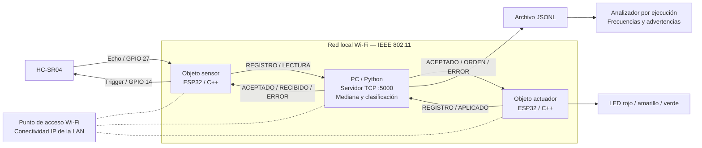
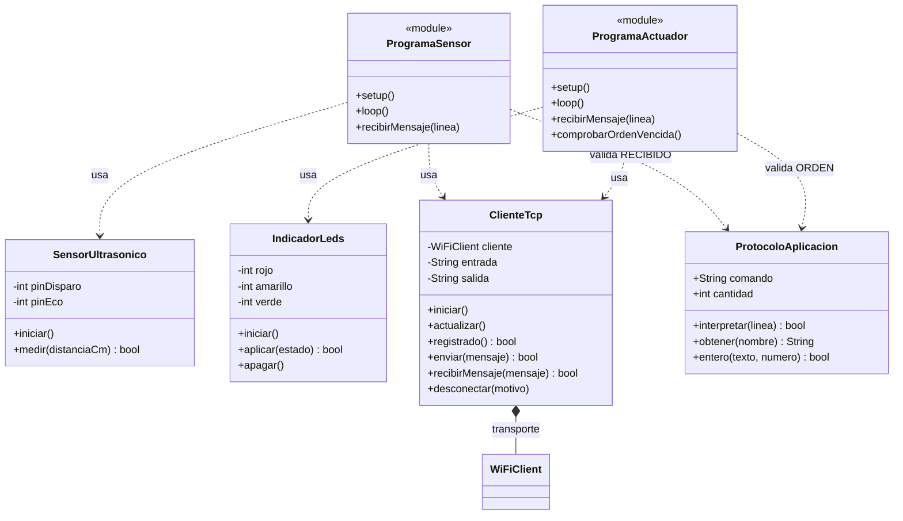
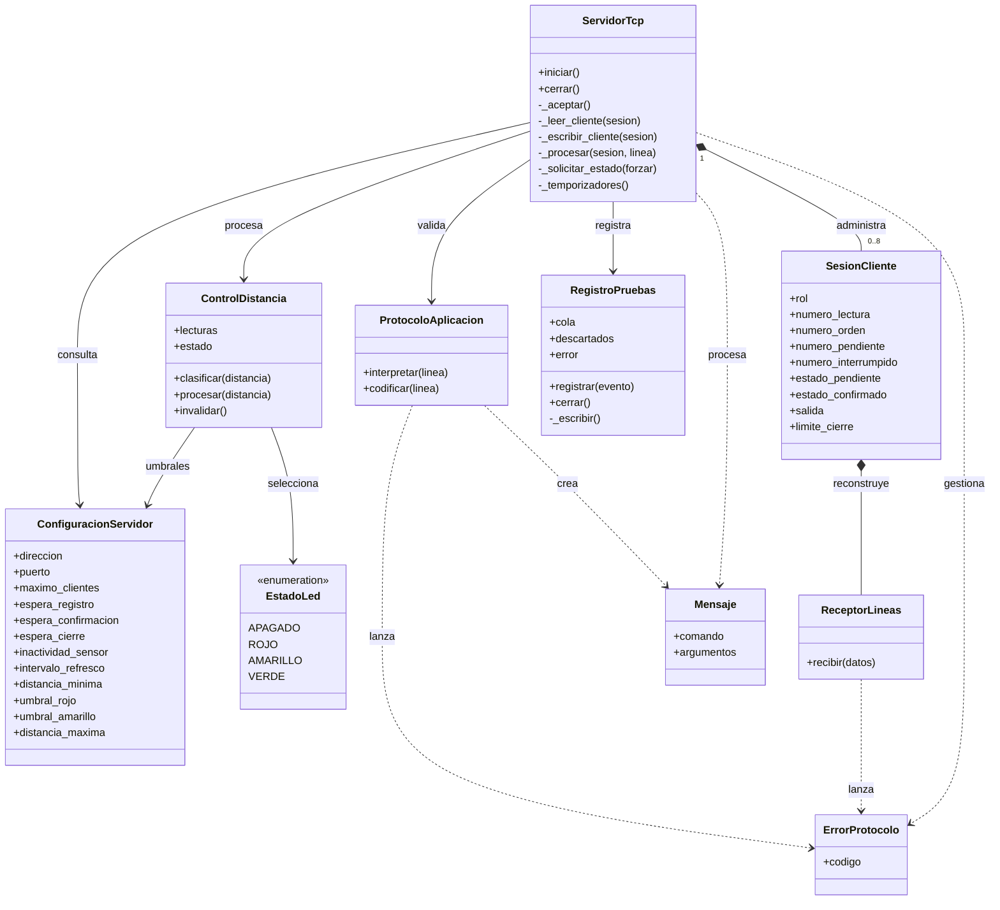
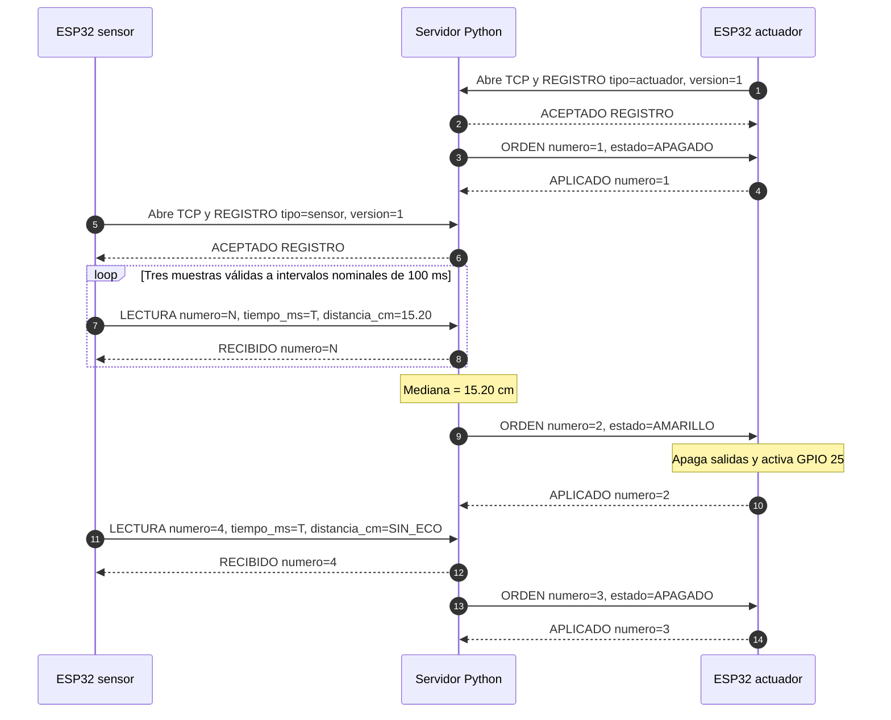
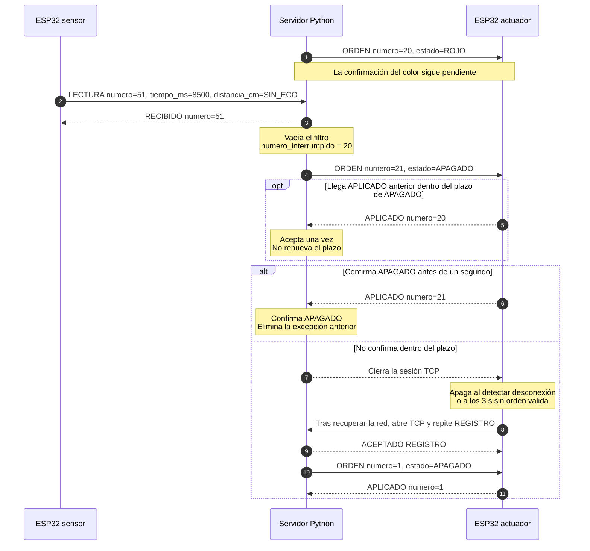

# Práctica 2 — Integración de Objetos Inteligentes con TCP/IP

**Asignatura:** Internet de las Cosas — SIS-234  
**Institución:** Universidad Católica Boliviana «San Pablo»  
**Integrantes:** María Jesús Lozada Peralta · Samuel Jarro Rodriguez · Katherine Montaño Mejia  
**Proyecto:** Medición ultrasónica distribuida y señalización mediante tres LEDs  
**Fecha:** 13 de octubre de 2026  
**Versión de software analizada y probada:** rama `maria-correcciones`, commit `147c6491870a6020d1d643bce92749b508417fa5`.  
**Repositorio:** [Sam-J-R/IoT_practica_2](https://github.com/Sam-J-R/IoT_practica_2).

## Resumen

Se desarrolló un sistema distribuido formado por dos ESP32 y una computadora conectados mediante una red local Wi-Fi. El primer ESP32 adquiere distancias con un sensor HC-SR04; el servidor Python procesa las lecturas mediante una mediana móvil de tres muestras y determina el estado de señalización; el segundo ESP32 ejecuta las órdenes y controla tres LEDs. Los rangos definidos son rojo entre 2 y 10 cm, amarillo por encima de 10 hasta 20 cm y verde por encima de 20 hasta 30 cm. Las lecturas fuera del intervalo de trabajo o sin eco solicitan el apagado.

La comunicación utiliza sockets TCP y un protocolo textual propio en español. El servidor emplea hilos independientes para recepción, transmisión, supervisión y registro de eventos, con colas acotadas y sincronización del estado compartido. La implementación incorpora confirmaciones, reconexiones, prioridad de apagado, control de errores y análisis de registros por ejecución.

La validación obtuvo **27 pruebas Python y 17 pruebas Unity aprobadas**, además de la compilación satisfactoria de ambos firmwares ESP32. Los resultados documentan la lógica, el protocolo, la recuperación y el análisis de registros comprobados. La exactitud, la estabilidad prolongada y la respuesta física de extremo a extremo mantienen sus criterios de aceptación y requieren mediciones del prototipo.

## 1. Requerimientos funcionales y no funcionales

### 1.1. Alcance

El sistema integra un objeto sensor, un objeto actuador y un servidor central. Ambos ESP32 inician conexiones TCP hacia la computadora; no intercambian lecturas directamente entre sí. La decisión del color reside en el servidor. Se requiere una red local que permita comunicación entre clientes y acceso al puerto TCP 5000 de la computadora. La operación local no requiere conexión a Internet.

### 1.2. Requerimientos funcionales

| ID | Comportamiento requerido | Criterio de aceptación |
|---|---|---|
| RF1 | Obtener la distancia entre el sensor ultrasónico y un objeto. | Transmitir centímetros o indicar `SIN_ECO` cuando no se obtiene una medición representable. |
| RF2 | Clasificar la distancia en tres rangos contiguos y sin solapamiento. | Asignar exactamente un color a cada distancia filtrada dentro de 2–30 cm, según la tabla de rangos. |
| RF3 | Representar el rango mediante tres LEDs. | Encender únicamente el LED solicitado o apagar los tres ante `APAGADO`. |
| RF4 | Intercambiar lecturas y órdenes mediante sockets TCP sobre Wi-Fi. | Registrar los dos roles y completar las secuencias de lectura, orden y confirmación definidas. |
| RF5 | Recuperarse de pérdida de conexión y datos inválidos. | Apagar conforme a las condiciones y plazos de §2.7; volver a registrar los clientes después de reconectar. |
| RF6 | Permitir verificar el procesamiento de lecturas y la aplicación lógica de órdenes. | Asociar `RECIBIDO` con una lectura enviada y `APLICADO` con la orden correspondiente. |
| RF7 | Filtrar lecturas antes de decidir el color. | Utilizar la mediana de tres lecturas válidas consecutivas; un dato inválido vacía la ventana y exige tres nuevas muestras. |
| RF8 | Identificar y administrar los roles de los clientes. | Mantener como máximo un sensor y un actuador registrados; un nuevo cliente del mismo rol reemplaza al anterior. |
| RF9 | Registrar los eventos del servicio para su análisis. | Generar eventos JSONL con fecha, reloj monotónico y datos del evento; informar descartes o fallos del registro por los medios disponibles. |
| RF10 | Analizar registros de distintas ejecuciones. | Separar los tramos delimitados por inicio/cierre; distinguir adquisición, recepción y lecturas válidas, y advertir evidencia incompleta. |

RF1–RF4 corresponden a la consigna; RF5–RF10 documentan comportamientos adicionales ya implementados por el equipo.

### 1.3. Rangos de operación

| Distancia filtrada `d` | Estado | Rojo | Amarillo | Verde |
|---|---|:---:|:---:|:---:|
| 2 ≤ d ≤ 10 cm | ROJO | Encendido | Apagado | Apagado |
| 10 < d ≤ 20 cm | AMARILLO | Apagado | Encendido | Apagado |
| 20 < d ≤ 30 cm | VERDE | Apagado | Apagado | Encendido |
| d < 2 cm, d > 30 cm o `SIN_ECO` | APAGADO | Apagado | Apagado | Apagado |

Los colores son fijos. Los límites 10, 20 y 30 cm pertenecen respectivamente a rojo, amarillo y verde. Una lectura inválida borra inmediatamente el filtro; se requieren tres lecturas válidas consecutivas para recuperar un color. El dominio representable del protocolo, de 0 a 400 cm, es más amplio que el intervalo utilizado para controlar los LEDs.

### 1.4. Requerimientos no funcionales

| ID | Atributo | Meta declarada | Verificación |
|---|---|---|---|
| RNF1 | Estabilidad | 15 minutos continuos sin reinicios ni bloqueos. | Registro de inicio y fin, actividad de ambos ESP32 y eventos del servidor. |
| RNF2 | Exactitud | Error absoluto máximo ≤ 3 cm dentro de 2–30 cm. | Diez lecturas por punto frente a una referencia física. |
| RNF3 | Respuesta | ≤ 1 s desde el cambio físico de rango hasta el cambio visible del LED, en operación normal. | Pendiente de medición extremo a extremo con una referencia temporal común; las confirmaciones de software no sustituyen esa medición. |
| RNF4 | Muestreo | ≥ 2 adquisiciones/s y ≥ 2 lecturas válidas/s con un objeto estable dentro del rango. | Marcas temporales del sensor y conteo de registros válidos; recepción evaluada por separado. |
| RNF5 | Confiabilidad | Detectar errores y recuperar sesiones mediante los plazos de §2.7. | Pruebas de confirmaciones, desconexiones, agotamiento de tiempos y recuperación. |
| RNF6 | Mantenibilidad | Código modular y orientado a objetos, con responsabilidades identificables y documentación. | Revisión de módulos, clases, configuración y pruebas existentes. |
| RNF7 | Aislamiento de operaciones lentas | La espera de red de una sesión y la escritura de registros no deben retener el bloqueo global del control; los errores del destino de registro no deben propagarse al productor. | Inspección de lectores/escritores y pruebas existentes de consola bloqueada, fallo de disco y cierre acotado. |
| RNF8 | Uso acotado de recursos | Como máximo 8 conexiones, 32 mensajes en cola de salida por sesión, 1024 eventos en cola de registro por defecto y 512 bytes de salida por ESP32; retirar las referencias a hilos terminados. | Inspección de límites y prueba existente de liberación de hilos tras reconexiones. Los límites no equivalen a memoria total constante. |
| RNF9 | Compatibilidad del protocolo | Aplicar en Python y C++ la misma regla de espacios y el límite de mensaje de 128 bytes incluido el terminador. | Pruebas existentes de sintaxis en ambos lenguajes y longitud en Python; revisión del receptor C++. |
| RNF10 | Reproducibilidad | Compilar ambos firmwares y conservar salidas, comandos y huellas de fuentes de la validación. | Ejecución del validador y registros de §4; el reintento Unity debe acompañar al manifiesto original. |

Los valores de RNF1–RNF4 son objetivos de aceptación, no resultados físicos ya medidos. La elección de 15 minutos y diez lecturas por punto concreta el método del equipo.

### 1.5. Trazabilidad entre requisitos, implementación y verificación

| Requisito | Componentes | Prueba o procedimiento | Evidencia / alcance actual |
|---|---|---|---|
| RF1 | `SensorUltrasonico`, programa sensor | Unity `probarConversionDelEco`, `probarAusenciaDeEcoYLimite`; F2 | Conversión y casos de eco simulados aprobados; adquisición física pendiente de documentar. |
| RF2 | `ControlDistancia` | Python `test_fronteras_y_datos_no_confiables`, `test_espera_tres_lecturas_y_rechaza_un_pico`; F1 | Fronteras y mediana aprobadas en software. |
| RF3 | `IndicadorLeds`, programa actuador | Unity `probarColoresExclusivos`, `probarActuacionYConfirmacionParcial`; F1 | GPIO y confirmación simulados aprobados; luz física pendiente. |
| RF4 | `ClienteTcp`, `ServidorTcp`, analizadores del protocolo | `test_colores_decimales_y_sin_eco`, `test_fragmentacion_concatenacion_y_crlf`; F1 | TCP real en localhost y firmware simulado aprobados; red Wi-Fi física pendiente. |
| RF5 / RNF5 | Supervisor, reconexión, apagado local | `test_sensor_rechazado_apaga_antes_de_confirmar_color`, `test_confirmacion_agotada`, Unity `probarReconexionYLimpieza`; F5 | Escenarios de software aprobados. |
| RF6 | Secuencias y confirmaciones | `test_confirmacion_incorrecta_rechazada`, `test_confirmacion_interrumpida_tardia_no_renueva_el_plazo` | Asociación de confirmaciones aprobada en los casos cubiertos. |
| RF7 | `ControlDistancia` | `test_espera_tres_lecturas_y_rechaza_un_pico`, `test_error_vacia_el_filtro_y_exige_tres_nuevas` | Filtrado y reinicio de ventana aprobados. |
| RF8 | Roles de `ServidorTcp` | `test_reemplazo_de_sensor`, `test_secuencia_repetida_y_rol_equivocado` | Reemplazo y restricciones de rol comprobados. |
| RF9 | `RegistroPruebas` | `test_error_de_disco_no_sale_al_productor_y_cierra_el_archivo`; inspección del productor JSONL | Manejo del fallo probado; estructura y contador de descartes revisados en código. |
| RF10 | Analizador JSONL | Las tres pruebas de `test_analizar_registro.py` | Separación, frecuencias, evidencia incompleta y desbordamiento de reloj aprobados. |
| RNF1 | Sistema completo y registros | F4 | Pendiente de ensayo físico continuo. |
| RNF2 | Sensor, geometría y referencia | F2 | Pendiente de medidas repetidas. |
| RNF3 | Cadena sensor–servidor–actuador | F3 | Estimación del filtro disponible; tiempo completo pendiente. |
| RNF4 | Programa sensor y analizador JSONL | `test_separa_ejecuciones_y_frecuencias`; F4 | Cálculo de frecuencias aprobado con datos de prueba; frecuencia física pendiente. |
| RNF6 | Clases de §2.4 y módulos de §3 | Inspección y compilaciones | Organización modular y compilación verificadas. |
| RNF7 | Escritores TCP y registro asíncrono | `test_consola_bloqueada_no_detiene_tcp_ni_supervision`, `test_cierre_no_espera_indefinidamente_al_disco`; inspección de `sendall` | Escenarios indicados aprobados; no constituye una medición de carga máxima. |
| RNF8 | Sesiones, colas, búferes y lista de hilos | `test_reconexiones_liberan_hilos_lectores_y_escritores`; inspección de constantes | Limpieza de hilos aprobada y capacidades verificadas por lectura; sin ensayo exhaustivo de saturación. |
| RNF9 | Analizadores Python/C++ y receptores de líneas | `test_datos_rechazados`, `test_limite_incluye_terminador`, Unity `probarMensajesIncorrectos` | Regla de espacios comprobada en ambos lenguajes; límite revisado según alcance indicado. |
| RNF10 | PlatformIO y validador | Dos compilaciones, 27 casos Python y 17 Unity | Evidencias actuales y huellas disponibles en anexo A. |

F1–F5 se definen en §4.4. Los archivos de prueba y resultados se enlazan en §4.2 y §8.

## 2. Análisis y diseño

### 2.1. Arquitectura del sistema



Las flechas entre equipos representan mensajes de aplicación; las conexiones punteadas representan acceso a la misma LAN, sin constituir conexiones TCP adicionales. Ambos objetos abren sus propias conexiones hacia la PC. El archivo y el analizador son componentes de software de la computadora. Las capas utilizadas son: protocolo propio de mensajes, TCP, IP y acceso Wi-Fi. TCP entrega bytes ordenados; el protocolo de aplicación agrega límites de mensajes, roles, secuencias y significado a esos bytes.

### 2.2. Componentes y circuito del objeto sensor

| Componente | Cantidad | Función |
|---|---:|---|
| DOIT ESP32 DevKit v1 | 2 | Clientes de sensado y actuación. |
| HC-SR04 | 1 | Adquisición ultrasónica. |
| LED rojo, amarillo y verde | 1 de cada color | Señalización del rango. |
| Resistencia de 220 Ω | 3 | Limitación de corriente, una por LED. |
| Protoboard, cables y alimentación USB | Según montaje | Conexión y alimentación de los objetos. |
| Computadora y red Wi-Fi | 1 puesto servidor | Coordinación y transporte TCP. |


**Figura 1.** Conexiones declaradas para el objeto sensor: VCC a 5 V, GND común, Trigger al GPIO 14 y Echo al GPIO 27. Se representa el montaje indicado por el equipo, sin resistor ni divisor en Echo. La figura describe conexiones previstas; no es una fotografía del prototipo.

**Limitación eléctrica:** la supresión del divisor no cambia el programa, pero tampoco adapta la tensión de Echo. Una señal de 5 V no es compatible con el límite de entrada indicado para los GPIO del ESP32 a 3,3 V (`VDD + 0,3 V`). Por ello, este montaje no se presenta como eléctricamente validado; la compatibilidad del módulo utilizado debe comprobarse antes de energizar esa conexión. Fuente: [Espressif, ESP32-WROOM-32, características de entrada](https://documentation.espressif.com/esp32_wroom-32_datasheet_en.pdf).

### 2.3. Circuito del objeto actuador


**Figura 2.** Tres ramas independientes: GPIO 33 → resistencia de 220 Ω → ánodo del LED rojo; GPIO 25 → resistencia → ánodo amarillo; GPIO 26 → resistencia → ánodo verde. Los cátodos van a GND. Los símbolos indican la polaridad y la emisión luminosa. Estas tres resistencias permanecen en el montaje; la eliminación indicada se refiere exclusivamente a Echo.

### 2.4. Diagramas de clases

Clases C++ utilizadas por los dos programas:



Los elementos con estereotipo `module` representan `sensor/main.cpp` y `actuador/main.cpp`, no clases C++ adicionales. Se incluyen para mostrar quién utiliza cada clase y evitar relaciones ficticias entre sensor, transporte y LEDs. Las flechas punteadas indican uso y el rombo lleno indica que `WiFiClient` es un miembro de `ClienteTcp`. El parser C++ valida estructura y números, mientras que cada programa valida el comando y los campos esperados para su rol.

Clases del servidor Python:



`ProtocoloAplicacion` existe en ambos lenguajes con responsabilidades complementarias. El servidor valida además el esquema completo de cada comando; `ServidorTcp` comprueba permisos por rol y secuencias dentro de la sesión.

### 2.5. Concurrencia y gestión de recursos

El servidor crea un hilo aceptador, uno supervisor y dos hilos por cliente: lector y escritor. `RegistroPruebas` incorpora otro hilo para escribir eventos. Con dos clientes activos, la aplicación dispone normalmente de siete hilos de trabajo más el principal. El `RLock` protege sesiones, roles, filtro y órdenes, mientras que `recv()` y `sendall()` esperan fuera del bloqueo global.

La cola de salida de cada sesión admite 32 mensajes. Si se llena, se cierra esa sesión. La cola de registro admite por defecto 1024 eventos; cuando se satura, descarta nuevos eventos y contabiliza la pérdida mediante `REGISTROS_DESCARTADOS`. Un fallo del archivo o de la consola deshabilita ese destino sin propagar la excepción al control TCP.

Los hilos de conexión se retiran de la lista al terminar. Una excepción inesperada en un hilo gestionado por `ServidorTcp` detiene el servicio y cierra las sesiones, evitando mantener una ejecución incompleta. Se permiten hasta ocho conexiones simultáneas, aunque solo existe un sensor y un actuador activos por rol. Un nuevo registro del mismo rol reemplaza al anterior.

### 2.6. Protocolo de aplicación y secuencia

**Formato:** ASCII, una línea por mensaje, terminada en LF; se acepta CRLF. Máximo 128 bytes incluido el terminador. La forma general es `COMANDO clave=valor, clave=valor`. Se exige exactamente un espacio después del comando y se admite cero o un espacio después de cada coma. No se admiten campos repetidos, desconocidos o ausentes. Los parámetros pueden aparecer en cualquier orden.

Los comandos distinguen mayúsculas y minúsculas. Los enteros son sin signo de hasta 4294967295. Lecturas y órdenes comienzan en 1 y crecen por sesión; `tiempo_ms` admite 0 y representa el reloj local del sensor. La distancia admite 0–400, con punto decimal, sin signo ni notación exponencial, o el literal `SIN_ECO`.

| Mensaje | Emisor → receptor | Campos y respuesta |
|---|---|---|
| `REGISTRO tipo=sensor, version=1` | Sensor → servidor | `tipo`: sensor o actuador; `version`: 1. Respuesta: `ACEPTADO REGISTRO`. |
| `REGISTRO tipo=actuador, version=1` | Actuador → servidor | Primer mensaje de su conexión. Recibe aceptación y el estado vigente. |
| `ACEPTADO REGISTRO` | Servidor → cliente | Texto fijo sin parámetros; permite iniciar el intercambio del rol. |
| `LECTURA numero=42, tiempo_ms=12500, distancia_cm=15.20` | Sensor → servidor | Número creciente, tiempo local y distancia. Respuesta: `RECIBIDO numero=42`. |
| `RECIBIDO numero=42` | Servidor → sensor | Confirma procesamiento. Debe crecer y no superar la última lectura enviada. |
| `ORDEN numero=81, estado=AMARILLO` | Servidor → actuador | Número creciente y uno de ROJO, AMARILLO, VERDE o APAGADO. |
| `APLICADO numero=81` | Actuador → servidor | Confirma escrituras de GPIO; debe corresponder a la orden vigente o a la excepción de apagado descrita debajo. |
| `ERROR codigo=FORMATO` | Servidor → cliente | Comunica rechazo y termina la sesión. El servidor también acepta ERROR del cliente; los firmwares actuales cierran directamente ante errores locales. |

Las respuestas no generan otra confirmación. La recepción reconstruye líneas fragmentadas y separa líneas concatenadas. Entre los errores se distinguen `FORMATO`, `LONGITUD`, `COMANDO`, `FALTANTE`, `ARGUMENTO`, `DUPLICADO`, `VALOR`, `VERSION`, `SIN_REGISTRO`, `YA_REGISTRADO`, `ROL`, `SECUENCIA`, `CONFIRMACION` y `CONFIRMACION_TARDIA`. La gramática completa y los ejemplos adicionales están en [protocolo.md](protocolo.md).



**Figura 3.** Secuencia ilustrativa del protocolo; no es una captura experimental. N y T representan valores reales del contador y del reloj local. Los clientes pueden registrarse en cualquier orden. Si existe un color calculado vigente, el actuador lo recibe al registrarse.

Normalmente se mantiene una orden vigente pendiente de confirmación. Los cambios posteriores actualizan el estado deseado. Como excepción, `APAGADO` puede interrumpir un color pendiente: se encola sin esperar su confirmación, conservando el orden TCP de los bytes ya en tránsito. Se guarda como máximo un `numero_interrumpido`; su confirmación se acepta una sola vez, mientras el apagado sigue pendiente y dentro de su plazo. No renueva el plazo ni cambia el estado confirmado. Al confirmar el apagado se elimina esa excepción.



**Figura 4.** Apagado prioritario y recuperación, suponiendo que no llegan nuevas lecturas válidas durante la secuencia. El evento de cierre representa transporte TCP, no un comando adicional. Si se recupera un estado válido antes de reconectar, el servidor entrega ese estado vigente. Esta secuencia complementa el funcionamiento normal y hace explícita la excepción de confirmaciones antiguas.

### 2.7. Condiciones de fallo y temporizaciones

| Situación | Plazo configurado | Respuesta |
|---|---:|---|
| Cliente sin registro / ESP32 sin aceptación | 3 s | Cierre de sesión y posterior reconexión del ESP32. |
| Sensor sin nuevas lecturas | 5 s | Retirar sensor, vaciar filtro y solicitar apagado. `SIN_ECO` bien formado sí cuenta como actividad. |
| Orden sin confirmación válida | 1 s desde que se encola | Cerrar actuador; el plazo incluye espera de transmisión. |
| Sensor con lecturas sin confirmación | 1 s sin avance de confirmaciones | Desconectar y volver a registrar. |
| Actuador sin orden válida | 3 s desde la última | Apagado local, incluso si TCP aparenta seguir conectado. |
| Pérdida Wi-Fi/TCP detectada por actuador | Al detectarse | Apagado local y limpieza de sesión. |
| Refresco del estado | 1 s | Reenviar estado, respetando la confirmación pendiente. |
| Reintentos Wi-Fi/TCP | Aproximadamente 2 s | Intentar recuperar conexión; cada intento TCP tiene límite de 250 ms. |
| Salida pendiente del ESP32 | 1 s | Cerrar si no se completa el envío. |
| Rechazo de protocolo por servidor | Cierre total a partir de 0,5 s | Retirar el rol de inmediato, intentar enviar ERROR y cerrar aunque el escritor no avance. |

El supervisor se ejecuta aproximadamente cada 25 ms. Los plazos están sujetos a la ejecución del bucle y del sistema operativo; no son garantías de tiempo real estricto. Los tiempos de detección de fallos de 3 y 5 segundos no se confunden con el objetivo de respuesta normal de RNF3.

### 2.8. Dimensionamiento temporal del diseño

Los siguientes cálculos explican la elección del período y del filtro. Describen el diseño bajo condiciones ideales; su verificación física corresponde a RNF1–RNF4.

| Magnitud | Estimación o valor previsto | Base y condiciones |
|---|---|---|
| Frecuencia nominal de adquisición | ≈ 10 intentos/s | `1000 / 100 ms`, con conexión registrada y bucle sin retrasos adicionales. Incluye intentos sin eco. |
| Intentos en 15 minutos | ≈ 9000 | `900 s × 10 intentos/s`, sin interrupciones. No representa un conteo observado ni implica que sean válidos. |
| Tiempo de eco para 2 cm | ≈ 116,6 µs | `2 / 0,01715`, modelo utilizado por el firmware. |
| Tiempo de eco para 15 cm | ≈ 874,6 µs | `15 / 0,01715`. |
| Tiempo de eco para 30 cm | ≈ 1749,3 µs | `30 / 0,01715`. |
| Espera inicial del filtro | ≈ 200 ms entre primera y tercera adquisición | Tres muestras consecutivas separadas por 100 ms. Se agrega el tiempo de completar la última medición y comunicarla. |
| Recuperación desde filtro vacío después de un cambio físico | ≈ 200–300 ms de espera de muestreo | Según la fase del cambio respecto al siguiente disparo; requiere tres muestras válidas nuevas. No incluye red ni actuación. |
| Transición entre dos rangos estables con ventana llena | ≈ 100–200 ms de espera de muestreo | Dos muestras del nuevo rango dominan la mediana; objeto estable y salto claro de rango. No es válido para señales oscilantes. |
| Representación de distancia | Paso textual de 0,01 cm | Dos decimales transmitidos. La precisión de representación no equivale a exactitud del sensor. |
| Confirmaciones de lecturas en régimen ideal | ≈ 10 RECIBIDO/s | Si se reciben y procesan diez lecturas por segundo sin interrupciones. |
| Órdenes con estado constante | Aproximadamente una por segundo | Refresco de 1 s sujeto a confirmación y planificación; los cambios agregan órdenes. |

Por ejemplo, una respuesta normal puede expresarse como `t_total = espera_de_muestreo_y_filtro + adquisición_final + transporte + procesamiento + actuación`. El código permite estimar la primera parte, pero no asignar un número medido a las demoras Wi-Fi y al cambio óptico. El plazo de confirmación de un segundo comienza al encolar una orden, después del filtrado; no demuestra por sí solo el cumplimiento de RNF3.

## 3. Desarrollo e implementación

### 3.1. Estructura del proyecto

```text
IoT_practica_2/
├── INFORME_TECNICO.md
├── platformio.ini
├── README.md
├── PLAN.md
├── protocolo.md
├── comun/
│   ├── ClienteTcp.h
│   ├── ProtocoloAplicacion.h
│   └── ConfiguracionRedEjemplo.h
├── firmware/
│   ├── include/sensor/SensorUltrasonico.h
│   ├── include/actuador/IndicadorLeds.h
│   └── src/
│       ├── sensor/       # main.cpp y SensorUltrasonico.cpp
│       └── actuador/     # main.cpp e IndicadorLeds.cpp
├── servidor/
│   ├── __main__.py
│   ├── servidor.py
│   ├── control.py
│   ├── protocolo.py
│   └── registro.py
├── pruebas/
│   ├── test_*.py
│   ├── analizar_registro.py
│   ├── validar_software.py
│   ├── dobles/
│   └── unity/            # test_sensor, test_actuador y test_componentes
└── documentacion/
    ├── diagramas/informe/
    └── evidencias/esenciales/
```

La estructura resume los módulos vigentes; las evidencias históricas se conservan en otras subcarpetas. [platformio.ini](platformio.ini) define `esp32_sensor`, `esp32_actuador` y `native`, fijando `espressif32@7.0.1` y `native@1.2.1`. Los filtros de fuentes compilan únicamente el programa correspondiente a cada placa. Python requiere versión 3.11 o posterior, entre otros motivos por el uso de `StrEnum`.

### 3.2. Adquisición y programa sensor

Fuentes: [SensorUltrasonico.cpp](firmware/src/sensor/SensorUltrasonico.cpp), [su cabecera](firmware/include/sensor/SensorUltrasonico.h) y [main.cpp del sensor](firmware/src/sensor/main.cpp).

El método `medir()` genera el pulso Trigger de 10 µs, mide Echo con `pulseIn(..., 30000)` y convierte su duración a centímetros. El fragmento central es:

```cpp
distanciaCm = duracion * centimetrosPorMicrosegundo;
```

La constante vale `0.01715f`, equivalente a dividir entre dos una velocidad aproximada de 0,0343 cm/µs por el recorrido de ida y vuelta. Sin eco o con resultado superior a 400 cm, la función devuelve `false`. El programa construye `SIN_ECO` o una distancia con dos decimales.

El control `ahora - ultimaLectura < intervaloLecturaMs` organiza adquisiciones nominales cada 100 ms. `pulseIn` puede bloquear durante su espera acotada; por ello no se describe todo el firmware como completamente no bloqueante. `tiempo_ms` se toma antes de adquirir el eco. Las respuestas se verifican por secuencia y, al reconectar, se reinician los contadores. Antes de desbordar el número máximo de lectura se solicita una sesión nueva.

### 3.3. Control central y filtro

Fuente: [control.py](servidor/control.py). `ConfiguracionServidor` agrupa rangos y plazos; `EstadoLed` define los cuatro estados; `ControlDistancia` encapsula validación, ventana y clasificación.

```python
if len(self.lecturas) == 3:
    ordenadas = sorted(self.lecturas)
    self.distancia_filtrada = ordenadas[1]
    self.estado = self.clasificar(self.distancia_filtrada)
```

La ventana contiene las tres lecturas válidas más recientes. Para `15, 29, 15`, la mediana es 15 cm. Un pico aislado dentro del intervalo puede quedar descartado por la mediana; una lectura fuera del intervalo provoca apagado y vacía la ventana. No existe histéresis adicional: oscilaciones repetidas alrededor de un umbral todavía pueden alternar el color.

### 3.4. Actuación y confirmación

Fuentes: [IndicadorLeds.cpp](firmware/src/actuador/IndicadorLeds.cpp), [su cabecera](firmware/include/actuador/IndicadorLeds.h) y [main.cpp del actuador](firmware/src/actuador/main.cpp).

Después de validar el estado, `aplicar()` ejecuta:

```cpp
apagar();
if (pin >= 0) digitalWrite(pin, HIGH);
```

El programa confirma con `APLICADO` después de escribir los pines. Comprueba el vencimiento de órdenes antes y después de atender el transporte. Una orden inválida provoca desconexión y apagado; una orden posterior válida puede restablecer la señalización después de un apagado por inactividad.

### 3.5. Transporte y coordinación

Fuentes: [ClienteTcp.h](comun/ClienteTcp.h), [parser C++](comun/ProtocoloAplicacion.h), [servidor.py](servidor/servidor.py) y [protocolo.py](servidor/protocolo.py).

El cliente compartido mantiene un búfer de salida de 512 bytes y utiliza `send(..., MSG_DONTWAIT)` para admitir envíos parciales sin esperar indefinidamente. Reconstruye una línea de entrada y entrega mensajes al programa de cada rol. La conexión usa una IPv4 literal y un intento limitado a 250 ms.

En Python, `ReceptorLineas` procesa bytes hasta LF y controla longitud y codificación. `ProtocoloAplicacion` valida parámetros y valores. `ServidorTcp._procesar()` comprueba rol y secuencia, procesa una lectura y emite su confirmación. Los escritores consumen colas FIFO independientes. Al rechazar un sensor, se retira su rol y se pide apagado antes de esperar la entrega de ERROR.

Se corrigió la diferencia de espacios entre lenguajes: Python solo elimina el espacio opcional de los campos posteriores a una coma. Por tanto, `ORDEN  numero=1, estado=ROJO` es rechazado tanto en Python como en C++, mientras que se aceptan las variantes con coma seguida de cero o un espacio.

### 3.6. Registro asíncrono y análisis de resultados

Fuentes: [registro.py](servidor/registro.py) y [analizar_registro.py](pruebas/analizar_registro.py).

Cada evento incluye fecha UTC y reloj monotónico. El productor encola el registro y un hilo independiente escribe en consola y archivo. El analizador divide el JSONL por `SERVIDOR_INICIADO` y `SERVIDOR_DETENIDO`, y agrupa las lecturas por sesión dentro de cada ejecución. Así evita unir identificadores de sesión reutilizados al reiniciar el servidor cuando se conservan los marcadores.

Para N lecturas, calcula:

- **Adquisición:** `(N − 1) / duración_sensor`, utilizando diferencias de `tiempo_sensor_ms`, solo si la secuencia es consecutiva y el reloj es coherente.
- **Recepción registrada:** `(N − 1) / duración_recepción`, con marcas monotónicas del evento LECTURA en el servidor.
- **Válidas recibidas:** número de lecturas de 2–30 cm posteriores a la primera, dividido entre la duración de recepción. Se utiliza el intervalo `(primera, última]` para mantener coherencia entre conteo y duración.

Se cuentan además `SIN_ECO` y distancias fuera del rango de control. El desbordamiento de `millis()` se trata mediante diferencias módulo 2³²; diferencias nulas o de media vuelta o más se consideran ambiguas. Se advierten huecos de secuencia, falta de lecturas iniciales, líneas dañadas, marcadores ausentes y eventos de pérdida o fallo del registro. Si se pierden ambos marcadores entre ejecuciones, la separación no puede garantizarse. La frecuencia de recepción describe lo registrado, no demuestra entrega sin pérdidas ni una frecuencia mínima sostenida.

### 3.7. Ejecución reproducible

Crear la configuración privada a partir de [ConfiguracionRedEjemplo.h](comun/ConfiguracionRedEjemplo.h), indicando la red y la IPv4 real de la computadora. El archivo privado está excluido mediante [.gitignore](.gitignore). Antes de publicar, también deben revisarse los valores del archivo de ejemplo, porque excluir el privado no oculta credenciales copiadas en otros archivos.

Desde la raíz del repositorio:

```powershell
python -m servidor --direccion 0.0.0.0 --puerto 5000 --registro registros/ensayo.jsonl
pio run -e esp32_sensor
pio run -e esp32_actuador
python -B -m unittest discover -s pruebas -p "test_*.py" -v
pio test -e native
python -B pruebas/analizar_registro.py registros/ensayo.jsonl
```

La carga utiliza el entorno y el puerto COM correspondiente a cada placa. El monitor serie funciona a 115200 baudios. La compilación verificada en este informe no implica que las placas hayan sido grabadas durante esa validación.

## 4. Pruebas y validaciones

### 4.1. Versión, entorno y alcance

Se utilizaron las pruebas existentes, sin agregar casos ni modificar código. La ejecución se realizó el 13 de octubre de 2026 sobre el commit indicado en portada, con Python 3.13.13 en Windows y PlatformIO. Unity utilizó el compilador nativo de MSYS2. Los firmwares se compilaron para `esp32doit-devkit-v1` con Arduino.

El primer intento tuvo restricciones de permisos para sockets locales y la carpeta de PlatformIO. Al ejecutarse con los permisos necesarios, Python y ambas compilaciones aprobaron. Unity requirió añadir el compilador instalado a la variable PATH del proceso; al repetir únicamente esa etapa, aprobó. Se conservaron los registros de ambos intentos. El [resultado final consolidado](documentacion/evidencias/esenciales/20261013T174415_489485Z/RESULTADO_FINAL.md) explica por qué el `resumen.json` del primer intento autorizado conserva `FALLIDO` para Unity y debe leerse junto con el registro de su reintento satisfactorio.

### 4.2. Pruebas automáticas ejecutadas

| Suite existente | Casos | Propósito | Resultado |
|---|---:|---|---|
| [test_control.py](pruebas/test_control.py) | 3 | Fronteras, mediana y recuperación tras dato inválido. | 3/3 |
| [test_protocolo.py](pruebas/test_protocolo.py) | 4 | Sintaxis, espacios, fragmentación, CRLF, longitud y codificación. | 4/4 |
| [test_integracion.py](pruebas/test_integracion.py) | 12 | TCP local, colores, confirmaciones, apagado, reconexión, hilos y consola bloqueada. | 12/12 |
| [test_analizar_registro.py](pruebas/test_analizar_registro.py) | 3 | Separación de ejecuciones, frecuencias, pérdidas y relojes. | 3/3 |
| [test_registro.py](pruebas/test_registro.py) | 2 | Error de disco y cierre sin espera indefinida. | 2/2 |
| [test_robustez_servidor.py](pruebas/test_robustez_servidor.py) | 3 | Cierre acotado, confirmación interrumpida tardía y fallo inesperado de hilo. | 3/3 |
| **Total Python** | **27** | Lógica y servicio TCP. | **27/27 aprobadas** |
| [Unity actuador](pruebas/unity/test_actuador/test_main.cpp) | 5 | Reconexión, desconexión, órdenes inválidas, envío parcial y apagado local. | 5/5 |
| [Unity componentes](pruebas/unity/test_componentes/test_main.cpp) | 6 | Parser, números, colores, apagado y conversión del eco. | 6/6 |
| [Unity sensor](pruebas/unity/test_sensor/test_main.cpp) | 6 | Reconexión, mensajes inválidos, envío bloqueado, registro, muestreo y confirmación tras pausa. | 6/6 |
| **Total Unity** | **17** | Firmware con dobles de Arduino, Wi-Fi, reloj y GPIO. | **17/17 aprobadas** |

Los casos Unity de ambos programas reutilizan [comprobar_cliente.h](pruebas/unity/comprobar_cliente.h). Las pruebas Python de integración utilizan sockets reales en localhost; algunas acortan los plazos de configuración para ejecutarse rápidamente. Las pruebas de robustez también emplean reloj y transporte controlados. Los resultados no equivalen a un ensayo Wi-Fi ni a una medición eléctrica de GPIO.

Evidencia de ejecución: [27 pruebas Python](documentacion/evidencias/esenciales/20261013T174415_489485Z/pruebas_python.txt) y [17 pruebas Unity con MSYS2](documentacion/evidencias/esenciales/20261013T174415_489485Z/pruebas_unity_msys2.txt).

### 4.3. Compilación de ambas placas

| Entorno | RAM estática informada | Flash del programa | Estado |
|---|---:|---:|---|
| `esp32_sensor` | 44 864 / 327 680 bytes — 13,7 % | 752 445 / 1 310 720 bytes — 57,4 % | SUCCESS |
| `esp32_actuador` | 44 848 / 327 680 bytes — 13,7 % | 751 393 / 1 310 720 bytes — 57,3 % | SUCCESS |

Fuentes: [compilación sensor](documentacion/evidencias/esenciales/20261013T174415_489485Z/compilacion_esp32_sensor.txt) y [compilación actuador](documentacion/evidencias/esenciales/20261013T174415_489485Z/compilacion_esp32_actuador.txt). Los porcentajes se refieren a los límites informados por ese entorno de compilación. La cifra de RAM no mide el máximo consumo dinámico durante la ejecución.

### 4.4. Plan de validación física

Estos procedimientos completan los requisitos que las pruebas de PC no pueden demostrar. **Su ejecución y sus resultados físicos no están acreditados por los registros actuales.**

| ID | Procedimiento | Criterio de aceptación | Evidencia a conservar |
|---|---|---|---|
| F1 — Integración y rangos | Registrar ambos ESP32; situar el objeto en cada rango y recorrer las fronteras de 2, 10, 20 y 30 cm; retirar el objeto. Esperar la renovación de la ventana del filtro en los casos válidos. | Colores según §1.3, un solo LED activo y apagado ante dato inválido. | Fotografías por estado, monitor serie, JSONL y versión cargada. |
| F2 — Exactitud | Fijar el sensor perpendicular a una superficie; tomar diez lecturas sin filtrar en 2, 5, 10, 15, 20, 25 y 30 cm, referidas al frente del transductor. | Máximo error absoluto ≤ 3 cm; informar por separado lecturas sin eco. | 70 intentos documentados, referencia física, media, dispersión y errores. |
| F3 — Respuesta | Medición pendiente: registrar el instante del cambio físico y la actuación visible utilizando instrumentación con una referencia temporal común. | Tiempo máximo ≤ 1 s en operación normal. | Registro instrumental del inicio, fin y resolución temporal; no disponible en esta entrega. |
| F4 — Estabilidad y frecuencia | Operar 900 s; conservar marcas de adquisición, eventos, monitores serie y conteos en ventanas de 10 s. | Sin reinicios ni bloqueos; ≥ 2 adquisiciones/s y ≥ 2 válidas/s con objeto estable. | Inicio/fin, secuencias, descartes, frecuencias por ventana y promedio. |
| F5 — Recuperación | Interrumpir por separado sensor, actuador, Wi-Fi y servidor; registrar detección, apagado y reconexión. | Comportamiento coherente con §2.7 y nueva sesión funcional. | Monitores serie, observaciones del montaje y registros correlacionados por eventos. |

Los puntos físicos exactos de una frontera pueden fluctuar por incertidumbre de medición. La clasificación matemática se comprueba con valores exactos en software; en el montaje se documenta la distancia realmente reportada y su dispersión, sin afirmar que la transición ocurre exactamente en una marca de cinta métrica.

### 4.5. Tratamiento de datos y análisis de errores

Para referencia `r` y lectura `dᵢ`, se registra error firmado `eᵢ = dᵢ − r`, error absoluto `|eᵢ|` y error relativo `100 |eᵢ| / r`. El máximo absoluto se obtiene de todas las mediciones válidas, sin anteponer signo negativo. Por punto se informa número de intentos, lecturas válidas, media y desviación estándar muestral. Los casos `SIN_ECO` no se convierten artificialmente en cero centímetros.

El tiempo extremo a extremo requiere una referencia temporal común para el cambio físico y la actuación. El registro disponible de `APLICADO` mide la confirmación de la orden, no ese recorrido completo. No se restan directamente `millis()` del ESP32 y el reloj monotónico de la PC, porque no están sincronizados.

El analizador calcula promedios por sesión, pero RNF4 exige revisar también ventanas: un promedio alto puede ocultar pausas. Un hueco en el archivo advierte evidencia incompleta y no permite atribuir automáticamente la pérdida a TCP. La estabilidad tampoco puede deducirse solo de una compilación ni del número previsto de lecturas.

## 5. Resultados obtenidos

### 5.1. Validación de software y compilación

Se aprobaron **44 casos automáticos existentes: 27 Python y 17 Unity**, y se generaron los binarios de ambos ESP32. Los casos respaldan la lógica de rangos, el filtrado, la estructura de mensajes, la separación de ejecuciones del registro y los escenarios de recuperación evaluados. El resultado final del software es satisfactorio dentro de esa cobertura; no se atribuye un porcentaje de cobertura de código porque no se midió.

Las dos correcciones revisadas quedan verificadas: el analizador diferencia adquisición, recepción y lecturas válidas sin unir sesiones de ejecuciones delimitadas; Python y C++ rechazan el doble espacio después del comando. La documentación de resultados utiliza las nuevas suites de 27 y 17 casos, sin trasladar los totales históricos de otros informes.

### 5.2. Resultados funcionales obtenidos en las pruebas

| Función evaluada | Resultado obtenido | Respaldo |
|---|---|---|
| Rangos y fronteras | La clasificación devolvió los estados definidos para los valores límite evaluados. | `test_fronteras_y_datos_no_confiables` aprobado. |
| Filtrado y recuperación | Se esperaron tres muestras, se rechazó el efecto del pico evaluado y se vació la ventana después del dato inválido. | Dos casos de filtrado de `test_control.py` aprobados. |
| Exclusión de colores | Los niveles GPIO simulados activaron únicamente el color seleccionado. | Unity `probarColoresExclusivos` aprobado. |
| Conversión ultrasónica | Con un pulso simulado de 1000 µs se obtuvo 17,15 cm dentro de la tolerancia de la prueba. | Unity `probarConversionDelEco` aprobado; no es una medida física. |
| Integración TCP | Se completaron registro, lecturas de los tres rangos, órdenes y confirmaciones en localhost. | `test_colores_decimales_y_sin_eco` aprobado. |
| Apagado y recuperación | Se verificaron los escenarios de inactividad, desconexión, rechazo del sensor y reconexión contemplados por las suites. | Python de integración y Unity aprobados. |
| Espacios del protocolo | Ambos parsers rechazaron el doble espacio tras el comando y aceptaron cero o un espacio tras la coma. | Python `test_datos_rechazados` y Unity `probarMensajesIncorrectos` aprobados. |
| Análisis por ejecución | Se generaron resúmenes separados para ejecuciones con el mismo identificador de sesión y marcadores completos. | `test_separa_ejecuciones_y_frecuencias` aprobado. |
| Registro incompleto | Se emitieron advertencias para datos dañados, marcadores ausentes y secuencias discontinuas; la adquisición quedó sin calcular cuando no era deducible. | Casos existentes del analizador aprobados. |
| Recursos y fallos del servidor | Se verificó la liberación de hilos y el cierre del servicio ante el fallo inesperado ensayado. | Casos existentes de integración y robustez aprobados. |

Los resultados corresponden a las entradas y condiciones controladas de las pruebas enlazadas en §4.2. Las pruebas con dobles verifican la ejecución del firmware sin atribuir al circuito valores que no se midieron.

### 5.3. Análisis de los resultados y alcance

La mediana reduce la influencia de una muestra aislada válida, a cambio de una espera de varias adquisiciones. No corrige un sesgo constante de distancia y no sustituye calibración ni referencia física. La orientación del objeto, el entorno acústico y la variación de velocidad del sonido pueden afectar las mediciones; no se asigna un error máximo experimental sin datos originales.

El apagado tiene prioridad lógica, pero no puede adelantar bytes ya transmitidos por TCP. El temporizador local del actuador aporta una respuesta autónoma cuando se pierde el servidor. La solución está orientada a una LAN de laboratorio: no incorpora autenticación de clientes ni TLS, y el registro de un mismo rol reemplaza al cliente anterior.

El informe anterior menciona funcionamiento físico y una observación de unos 15 minutos. Al corresponder a una versión previa y carecer aquí de registros instrumentados asociados al código actual, esas afirmaciones se conservan como antecedentes, sin utilizarlas para declarar cumplidos los RNF de esta versión. Tampoco se certifica la compatibilidad eléctrica del montaje Echo directo.

| Requisito medible | Situación sustentada actualmente |
|---|---|
| RNF1 — 15 minutos sin reinicios | Pendiente de registro continuo del prototipo. |
| RNF2 — error máximo ≤ 3 cm | Pendiente; no puede calcularse solo desde el código. |
| RNF3 — respuesta física ≤ 1 s | Pendiente de medición extremo a extremo. |
| RNF4 — frecuencia mínima | Configuración nominal de 10 Hz y analizador comprobados; falta medir mínimos por ventana en hardware. |

## 6. Conclusiones

1. Se implementó una arquitectura distribuida que separa sensado, procesamiento y actuación entre dos ESP32 y una computadora. El protocolo de aplicación define el significado de los mensajes sobre el flujo TCP y permite identificar clientes por rol.
2. El control utiliza tres rangos contiguos dentro de 2–30 cm, mediana móvil de tres muestras y apagado ante datos inválidos. El límite inferior es coherente con el rango de trabajo declarado, atendiendo la observación de la práctica anterior.
3. Las 27 pruebas Python, 17 pruebas Unity y dos compilaciones satisfactorias respaldan la implementación en los casos evaluados. El manejo de apagado prioritario, cierre acotado, registro asíncrono y limpieza de hilos mejora la respuesta ante fallos del software.
4. La corrección del analizador fortalece la trazabilidad de las cifras: separa ejecuciones delimitadas y distingue relojes, frecuencias y datos válidos. La regla de espacios quedó unificada entre Python y C++.
5. Los resultados obtenidos permiten concluir que los escenarios automáticos evaluados funcionan correctamente. El cumplimiento físico de exactitud, estabilidad, frecuencia mínima y respuesta requiere completar F1–F5 con las mediciones correspondientes.
6. La práctica desarrolla conocimientos de TCP/IP, programación orientada a objetos y concurrencia. La colaboración y las contribuciones individuales deben demostrarse con el historial real del repositorio y la explicación de cada integrante durante la defensa.

## 7. Recomendaciones

1. Completar F1–F5 con ambos firmwares de esta versión, fotografías y registros originales, priorizando fronteras, fuera de rango, ausencia de eco y recuperación.
2. Comprobar los niveles eléctricos del módulo concreto antes de conectar Echo al GPIO. La eliminación del resistor se refleja en el montaje, pero no constituye una validación de compatibilidad.
3. Comparar las medidas repetidas con el dimensionamiento de §2.8 y explicar discrepancias. Informar error absoluto sin signo, dispersión y proporción de lecturas inválidas.
4. Conservar un JSONL por ensayo y revisar advertencias de pérdida. Para demostrar frecuencia mínima, calcular ventanas además del promedio por sesión; para demostrar respuesta física, utilizar instrumentación con una referencia temporal común.
5. Publicar los registros del reintento Unity junto con el resultado consolidado, evitando interpretar el manifiesto del intento fallido fuera de contexto. Repetir la validación si cambia el código.
6. Revisar credenciales antes de publicar, enlazar el informe y las evidencias desde la rama de entrega y confirmar que los diagramas y enlaces se visualicen en GitHub. La versión aquí documentada es `maria-correcciones`; no se supone que sus cambios ya estén integrados en `main`.
7. Documentar los aportes con commits propios y preparar una defensa que abarque medición, mediana, TCP, mensajes, hilos y límites del montaje.

## 8. Anexos

### A. Evidencias vigentes

| Archivo | Qué demuestra |
|---|---|
| [Resultado final](documentacion/evidencias/esenciales/20261013T174415_489485Z/RESULTADO_FINAL.md) | Consolidación del intento inicial y la repetición de Unity. |
| [Pruebas Python](documentacion/evidencias/esenciales/20261013T174415_489485Z/pruebas_python.txt) | 27 casos aprobados. |
| [Unity con MSYS2](documentacion/evidencias/esenciales/20261013T174415_489485Z/pruebas_unity_msys2.txt) | 17 casos aprobados. |
| [Compilación sensor](documentacion/evidencias/esenciales/20261013T174415_489485Z/compilacion_esp32_sensor.txt) | Binario generado y recursos de compilación. |
| [Compilación actuador](documentacion/evidencias/esenciales/20261013T174415_489485Z/compilacion_esp32_actuador.txt) | Binario generado y recursos de compilación. |
| [Manifiesto original](documentacion/evidencias/esenciales/20261013T174415_489485Z/resumen.json) | Comandos, entorno y SHA-256 de fuentes; conserva el fallo inicial de Unity explicado en §4.1. |
| [Circuito sensor](documentacion/diagramas/informe/circuito_sensor.svg) | Montaje declarado sin resistor en Echo y advertencia de compatibilidad. |
| [Circuito actuador](documentacion/diagramas/informe/circuito_actuador.svg) | GPIO, resistencias, polaridad y masa de los LEDs. |

No se anexan fotografías ni capturas físicas inexistentes. Las evidencias de versiones anteriores no se emplean para sustituir las de esta ejecución.

### B. Formato para registrar las mediciones físicas

En exactitud se conservarán: `ensayo, fecha, version, referencia_cm, repeticion, numero_lectura, tiempo_sensor_ms, distancia_cm, error_firmado_cm, error_absoluto_cm, sin_eco`. En respuesta: `ensayo, transicion, instrumento, resolucion_temporal, instante_inicial, instante_final, tiempo_s`. En estabilidad: `ensayo, inicio, fin, intentos, validas, sin_eco, descartes, desconexiones, reinicios_observados`.

Las filas deben completarse durante el experimento. No se incluyen valores sintéticos en esas tablas para evitar confundir la proyección de diseño con evidencia física.

### C. Observaciones de la práctica anterior aplicadas

| Observación docente | Tratamiento en este informe |
|---|---|
| Rango cercano desde 0 cm incompatible con trabajo desde 2 cm. | Rangos coherentes y descarte explícito de d < 2 cm. |
| Requisitos mezclados con nombres de funciones. | Comportamientos en §1; implementación en §3. |
| Ausencia de trazabilidad. | Matriz requisito–componente–prueba–resultado en §1.5. |
| Circuito como flujo lógico, sin polaridades. | Dos esquemas eléctricos SVG separados. |
| Exactitud sin repeticiones y error absoluto con signo. | Método de diez lecturas por punto, dispersión y errores correctamente definidos. |
| Latencias sin instrumento y cifras sin logs. | Resultados enlazados a pruebas ejecutadas; tiempo físico declarado pendiente y dimensionamiento ubicado en análisis de diseño. |
| Enlaces locales y anexos inconsistentes. | Enlaces relativos del repositorio a archivos existentes y resultados de la ejecución actual. |
| Riesgo de Echo directo. | Montaje sin resistor según decisión del equipo, con limitación eléctrica explícita; no se declara resuelto. |
| Participación individual insuficientemente acreditada. | Uso del historial real para aportes, sin asignaciones inventadas. |

Los requisitos y valores de la Práctica 1 no se trasladaron a esta práctica; se aprovecharon únicamente sus observaciones metodológicas.

### D. Control de versión y aportes

El commit de referencia es `147c649` (`correcciones`). Para verificar las contribuciones se puede consultar el [historial de la rama](https://github.com/Sam-J-R/IoT_practica_2/commits/maria-correcciones) y ejecutar:

```powershell
git log --format="%h | %an | %ad | %s" --date=short
```

La autoría de un commit acredita una contribución registrada, pero no permite inferir quién montó o midió el prototipo. Las actividades físicas y el aporte de cada integrante deben respaldarse con sus registros correspondientes.

### E. Fuentes

1. Consigna suministrada: *Práctica 2 — Integración de Objetos Inteligentes con TCP/IP*, SIS-234, apartados 3 y 4.2 y rúbrica 5.2.
2. Código de la rama `maria-correcciones`, commit indicado en portada, y [protocolo de aplicación](protocolo.md).
3. Registros originales de validación enlazados en el anexo A.
4. *INFORME_TECNICO (4).md*: antecedente documental, actualizado con el código y la evidencia vigentes.
5. *Revision_P1_Grupo_6.md*: observaciones sobre trazabilidad, diagramas, evidencia, exactitud y análisis crítico; no constituye la rúbrica de esta práctica.
6. [Espressif: ESP32-WROOM-32 Datasheet](https://documentation.espressif.com/esp32_wroom-32_datasheet_en.pdf), características eléctricas de las entradas.

### F. Correspondencia de los diagramas con la rúbrica

| Diagrama exigido | Ubicación | Contenido revisado |
|---|---|---|
| Arquitectura del sistema | §2.1 | Dos clientes, servidor central, LAN/punto de acceso, sentidos de los mensajes, sensor, LEDs y análisis JSONL. |
| Circuito del objeto sensor | §2.2, figura 1 | Alimentación USB, 5 V del sensor, masa común, Trigger GPIO 14, Echo GPIO 27 sin resistor y niveles de señal. |
| Circuito del objeto actuador | §2.3, figura 2 | Alimentación, GPIO 33/25/26, resistencias de 220 Ω, ánodos, cátodos, símbolos LED y retorno a GND. |
| Diagrama de clases estructural | §2.4 | Clases C++ y Python, módulos de coordinación identificados como tales, atributos relevantes, operaciones y relaciones reales. |
| Diagrama de secuencia | §2.6, figuras 3 y 4 | Conexión, registro, lecturas, filtrado, órdenes, confirmaciones, apagado prioritario, vencimiento y reconexión. |

El conjunto cubre los tipos de diagrama requeridos por §4.2 de la consigna. Se muestran las clases propias y las dependencias relevantes; se omiten los detalles internos del SDK y de la biblioteca estándar. Los esquemas documentan el montaje declarado, pero no sustituyen su verificación física ni resuelven la incompatibilidad indicada en Echo. La existencia de los diagramas tampoco demuestra por sí sola el cumplimiento de los requisitos experimentales de la rúbrica.
