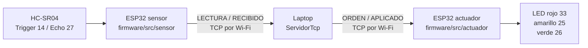
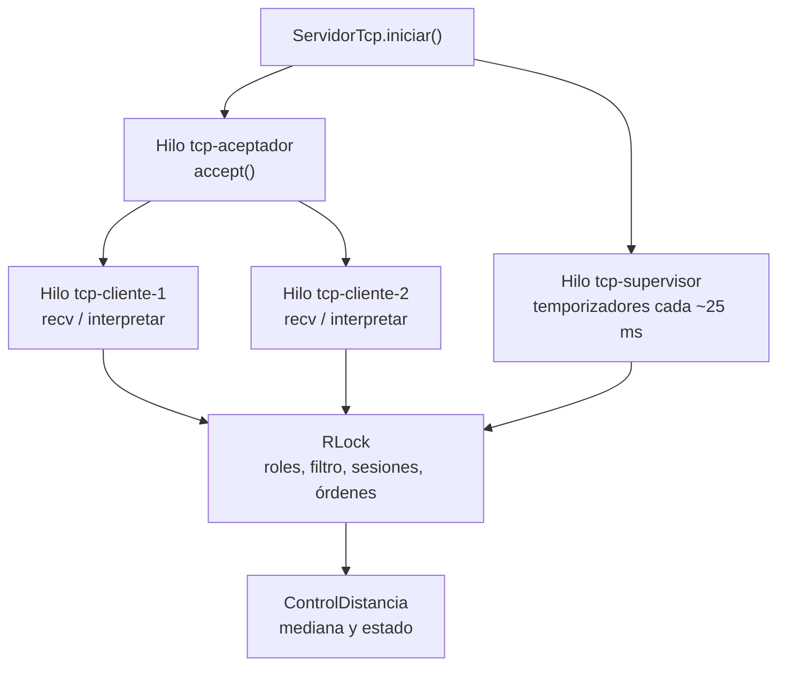
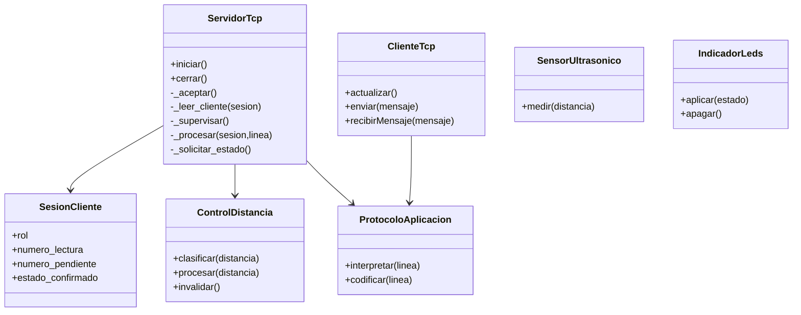
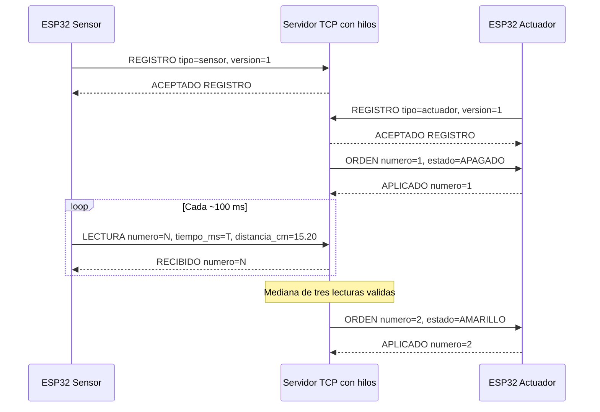

# Arquitectura del proyecto unificado por hilos

## 1. Objetivo

Implementar un objeto IoT distribuido con dos ESP32 y una laptop: la placa sensor adquiere distancias, el servidor clasifica y la placa actuador maneja tres LEDs. La aplicación se organiza en **un repositorio y un único proyecto PlatformIO**, con dos entornos de compilación independientes y **un servidor Python multihilo**.

## 2. Distribución

Los pines son los del montaje declarado, y las credenciales e IP de la laptop se configuran en `comun/ConfiguracionRed.h` (no se publica).

## 3. Concurrencia del servidor

- `tcp-aceptador` acepta conexiones y crea un hilo lector por conexión.
- `tcp-cliente-N` reconstruye mensajes TCP, valida comandos y actualiza la sesión.
- `tcp-supervisor` verifica el plazo de registro, la inactividad del sensor, las confirmaciones pendientes y el refresco periódico de órdenes.
- El `threading.RLock` evita cambios simultáneos de roles, secuencias, estado y órdenes. Solo la llamada `recv()` espera fuera del bloqueo. Los envíos son pequeños (≤ 128 bytes) y están limitados por un timeout de 250 ms; durante ese envío el bloqueo puede retrasar a otros clientes, una limitación aceptada para **dos** dispositivos. No se garantiza ejecución paralela de cálculos; los hilos permiten concurrencia de I/O.
- El cierre de sensor invalida el filtro y solicita `APAGADO`. La confirmación `APLICADO` demuestra que el firmware llamó a `digitalWrite`, no prueba por sí misma el estado eléctrico del LED.

Esta arquitectura sustituye el bucle `select` anterior. Para dos conexiones evita crear un despachador complejo de eventos y colas de escritura; el coste es la sincronización explícita mediante un bloqueo.

## 4. Diagrama de clases y responsabilidades

La medición física y el control de pines se mantienen encapsulados en C++. El servidor es el único lugar donde se deciden los colores; no se duplica esa lógica en el sensor o actuador.

## 5. Secuencia típica

`REGISTRO`, `LECTURA`, `ORDEN`, `APLICADO`, `RECIBIDO` y `ERROR` mantienen el contrato anterior; ver [protocolo.md](../protocolo.md) para errores y reglas de secuencia.

## 6. Proyecto PlatformIO único

El archivo [platformio.ini](../platformio.ini) crea tres entornos:

| Entorno | Fuentes compiladas | Propósito |
|---|---|---|
| `esp32_sensor` | `firmware/src/sensor/` | Carga en placa conectada al HC-SR04 |
| `esp32_actuador` | `firmware/src/actuador/` | Carga en placa conectada a los LEDs |
| `native` | `pruebas/unity/` | Pruebas simuladas con Unity en PC |

Los archivos `comun/ClienteTcp.h` y `comun/ProtocoloAplicacion.h` se comparten como cabeceras; no hay dos copias independientes del cliente TCP.

## 7. Consideraciones físicas

- **Echo HC-SR04:** resistencia 1 kΩ entre Echo y GPIO 27, resistencia 2 kΩ de GPIO 27 a GND; tensión teórica del nodo ≈ 3,33 V a 5 V nominal. Esto está ligeramente por encima de 3,3 V. Conviene verificar especificaciones de la placa y tolerancias, o cambiar la resistencia inferior a 1,8 kΩ si está disponible.
- **Trigger:** GPIO 14 al Trigger. HC-SR04 alimentado a 5 V con tierra común.
- **LEDs:** GPIO 33/25/26, cada uno con su resistencia de 220 Ω en serie y cátodo a GND.

## 8. Límites de las comprobaciones

Las pruebas de software verifican el comportamiento lógico y de sockets. No prueban el tiempo entre movimiento real de un objeto y encendido del LED, la tolerancia del divisor bajo carga ni el funcionamiento Wi-Fi tras esta refactorización. Se requiere repetir la demostración física con el nuevo firmware y servidor.
