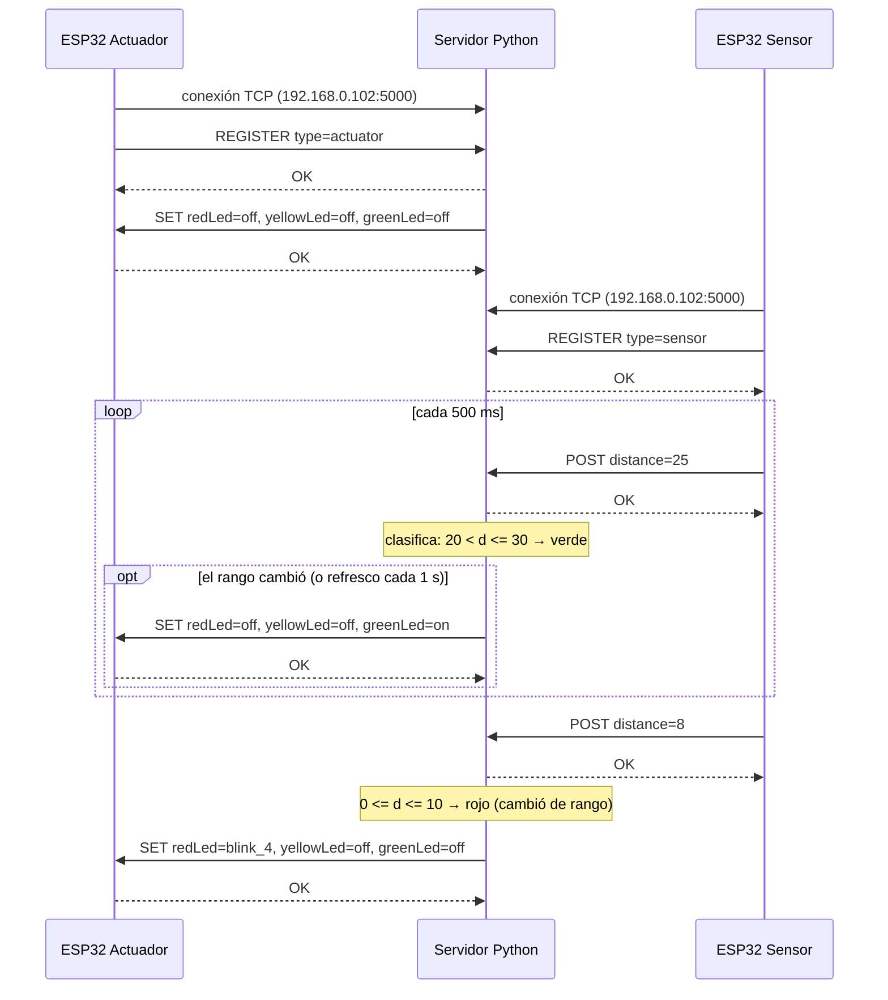
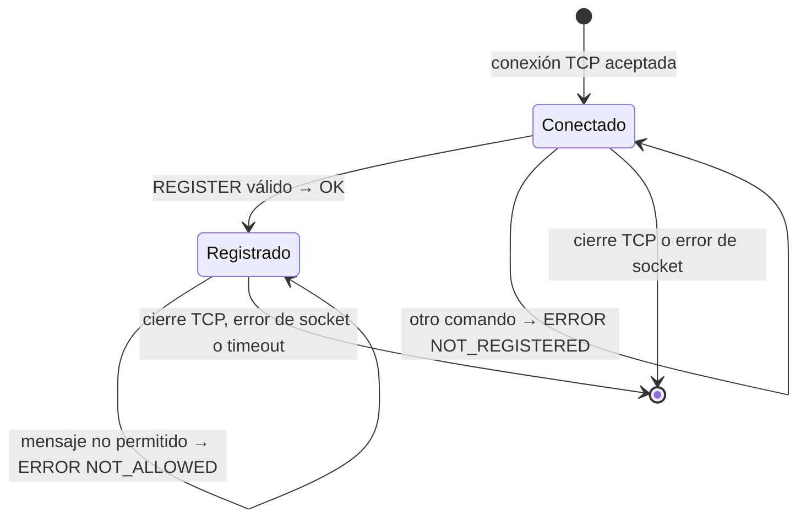
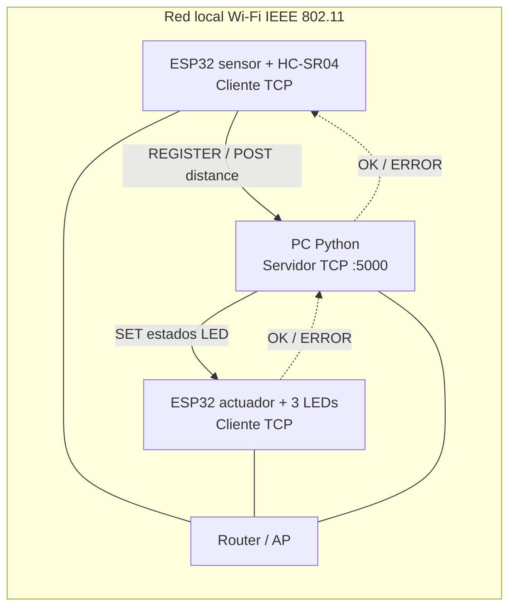

# Protocolo de aplicación — Práctica 2

Especificación del protocolo de aplicación de texto usado entre los dos objetos inteligentes (ESP32) y el servidor TCP (Python).

## 1. Visión general

El protocolo permite que:

- el **sensor** (ESP32 + HC-SR04) envíe al servidor la distancia medida;
- el **servidor** clasifique la distancia y ordene al **actuador** (ESP32 + 3 LEDs) qué LED encender y cómo.

| Elemento | Valor |
|---|---|
| Transporte | TCP sobre IP, WiFi (IEEE 802.11) |
| Servidor (IP de ejemplo, configurable) | `192.168.0.102`, puerto TCP **5000** |
| Actuador (ESP32; IP de ejemplo) | `192.168.0.100` |
| Sensor (ESP32; IP de ejemplo) | `192.168.0.101` |
| Quién inicia la conexión | Los dos ESP32 (clientes) se conectan al servidor |

Pila de capas:

```
Protocolo propio (REGISTER / POST / SET)
TCP
IP
IEEE 802.11
```

## 2. Convenciones de formato

- Codificación: **ASCII**.
- Cada mensaje es **una línea de texto terminada en `\n`**. El receptor también acepta `\r\n` (por ejemplo, el que envía Ncat con `-C`).
- Razón del delimitador: TCP es un flujo de bytes y **no conserva los límites de los mensajes**. Un `send()` puede llegar partido en varios segmentos o varios mensajes pueden llegar juntos, así que el receptor acumula bytes en un búfer y procesa un mensaje por cada `\n` encontrado.
- Longitud máxima de un mensaje: **128 bytes** (incluido el `\n`). Si se excede, el receptor responde `ERROR BAD_FORMAT` y descarta hasta el siguiente `\n`.
- Estructura general: `COMANDO arg=valor[, arg=valor]` (según el comando).
  - Comando y argumentos distinguen **mayúsculas y minúsculas** (`REGISTER`, `redLed`, `blink_4`).
  - Entre el comando y los argumentos va **un espacio**.
  - Los argumentos se separan con una coma. Quien envía **debe** usar `", "` (coma y espacio); quien recibe acepta la coma con o sin un espacio posterior.

## 3. Catálogo de comandos

### 3.1 `REGISTER`

Declara el rol del cliente. Es el primer mensaje que debe enviar cada ESP32 después de conectarse.

| Campo | Valor |
|---|---|
| Dirección | Cliente → Servidor |
| Argumento | `type` |
| Valores | `sensor`, `actuator` |
| Respuesta | `OK` o `ERROR <código>` |

```
REGISTER type=sensor
REGISTER type=actuator
```

### 3.2 `POST`

Envía una lectura de distancia.

| Campo | Valor |
|---|---|
| Dirección | Sensor → Servidor |
| Argumento | `distance` |
| Valores | Entero en **cm** entre 0 y 400, o `-1` si la lectura es inválida |
| Frecuencia | Una vez cada **500 ms** (2 lecturas/s) |
| Respuesta | `OK` o `ERROR <código>` |

```
POST distance=15
POST distance=-1
```

Notas:

- El sensor redondea al centímetro más cercano antes de enviar.
- El sensor envía `-1` cuando no recibe eco dentro del tiempo límite o la medición cae fuera del rango útil del HC-SR04.

### 3.3 `SET`

Ordena al actuador el estado de cada LED.

| Campo | Valor |
|---|---|
| Dirección | Servidor → Actuador |
| Argumentos | `redLed`, `yellowLed`, `greenLed` (los tres son obligatorios, cada uno una sola vez) |
| Valores | `on`, `off`, `blink_2` (2 Hz), `blink_4` (4 Hz) |
| Respuesta | `OK` o `ERROR <código>` |

```
SET redLed=off, yellowLed=on, greenLed=off
```

Significado de los valores:

| Valor | Efecto |
|---|---|
| `on` | LED encendido fijo |
| `off` | LED apagado |
| `blink_2` | Parpadea a 2 Hz (2 ciclos encendido/apagado por segundo) |
| `blink_4` | Parpadea a 4 Hz (4 ciclos encendido/apagado por segundo) |

## 4. Respuestas y códigos de error

Todo mensaje recibido se responde con una línea:

- `OK` tras `REGISTER`: rol registrado; tras `POST`: lectura validada y aceptada para procesamiento (no garantiza actuación física); tras `SET`: el actuador aplicó la configuración solicitada.
- `ERROR <código>`: el mensaje fue rechazado.

| Código | Cuándo se envía |
|---|---|
| `UNKNOWN_COMMAND` | El comando no es `REGISTER`, `POST` ni `SET` |
| `BAD_FORMAT` | El mensaje no cumple la gramática (§5) o excede 128 bytes |
| `MISSING_ARG` | Falta un argumento obligatorio |
| `INVALID_VALUE` | El valor está fuera de dominio (por ejemplo `type=robot`, `distance=900`) |
| `NOT_REGISTERED` | Se envió `POST` o `SET` antes de `REGISTER` |
| `ALREADY_REGISTERED` | Se envió `REGISTER` por una conexión ya registrada |
| `NOT_ALLOWED` | El comando no corresponde al rol (por ejemplo, un actuador envía `POST`) |
| `UNKNOWN_ARG` | Se recibió una clave de argumento no reconocida |
| `DUPLICATE_ARG` | Se repitió una clave de argumento |

## 5. Gramática formal (EBNF)

```ebnf
message        = ( register | post | set ), newline ;
newline        = "\n" ;                      (* el receptor también acepta "\r\n" *)

register       = "REGISTER", " ", "type=", ( "sensor" | "actuator" ) ;

post           = "POST", " ", "distance=", distance ;
distance       = "-1" | digit, { digit } ;  (* validar semánticamente 0..400; -1 es inválida *)

set            = "SET", " ", led-arg, sep, led-arg, sep, led-arg ;
                 (* las tres claves, cada una exactamente una vez; *)
                 (* se recomienda el orden redLed, yellowLed, greenLed *)
led-arg        = led-key, "=", led-value ;
led-key        = "redLed" | "yellowLed" | "greenLed" ;
led-value      = "on" | "off" | "blink_2" | "blink_4" ;
sep            = ",", [ " " ] ;

response       = ( "OK" | "ERROR", " ", error-code ), newline ;
error-code     = upper, { upper | "_" } ;

digit          = "0" | "1" | "2" | "3" | "4" | "5" | "6" | "7" | "8" | "9" ;
upper          = "A" | "B" | (* ... *) "Z" ;
```

## 6. Diagrama de secuencia



## 7. Estados de la conexión



Mensajes permitidos una vez registrado:

| Rol | Envía | Recibe |
|---|---|---|
| `sensor` | `POST` | respuestas `OK` / `ERROR` |
| `actuator` | respuestas `OK` / `ERROR` a cada `SET` | `SET` |

## 8. Manejo de fallos

| Situación | Comportamiento |
|---|---|
| El sensor no envía mensajes durante **5 s** | El servidor lo considera caído, cierra su conexión y envía `SET` con los tres LEDs en `off` al actuador. Cuando el sensor reconecta y se registra, el servicio se reanuda con el siguiente `POST`. |
| El sensor se desconecta (cierre TCP o error de socket) | Igual que el caso anterior: LEDs en `off`. |
| El actuador se desconecta | El servidor sigue aceptando `POST` y clasificando, pero sin enviar `SET`. Al reconectar y registrarse, el servidor le envía de inmediato el último estado calculado (o todo `off` si no hay lectura vigente). |
| Un cliente se registra con un rol ya ocupado | Se **reemplaza** la conexión anterior: el servidor cierra el socket viejo y adopta el nuevo. Evita que una conexión "fantasma" tras reiniciar un ESP32 bloquee su rol. |
| Se pierde el WiFi o el servidor en un ESP32 | El ESP32 reintenta la conexión cada **2 s** y, al lograrla, vuelve a enviar `REGISTER`. |
| `POST` con `distance=-1` | El servidor responde `OK` y trata la lectura como inválida: LEDs en `off`. |

Nota: el actuador no envía mensajes periódicos. Para evitar estados obsoletos, el servidor reenvía el estado vigente cada 1 s mientras haya sensor y actuador conectados; el actuador apaga todos los LEDs si pasan 3 s sin recibir un `SET` válido. El actuador debe implementar el parpadeo sin bloquear la lectura del socket. Estos intervalos son valores de diseño propuestos y deben verificarse en el código.

## 9. Lógica de control (distancia → LEDs)

Los rangos son contiguos y no se solapan; cada uno incluye su límite superior.

| Distancia `d` (cm) | Rango | `SET` enviado al actuador |
|---|---|---|
| `0 ≤ d ≤ 10` | Rojo | `SET redLed=blink_4, yellowLed=off, greenLed=off` |
| `10 < d ≤ 20` | Amarillo | `SET redLed=off, yellowLed=blink_2, greenLed=off` |
| `20 < d ≤ 30` | Verde | `SET redLed=off, yellowLed=off, greenLed=on` |
| `d > 30` o `d = -1` | Fuera de alcance / inválida | `SET redLed=off, yellowLed=off, greenLed=off` |

Reglas:

- El servidor envía `SET` inmediatamente cuando cambia el estado de los LEDs, al registrar el actuador, ante pérdida del sensor y, adicionalmente, **cada 1 s** como refresco de seguridad. No espera a que llegue otro `POST` para procesar un cambio.
- Cada `SET` incluye siempre los tres LEDs, de modo que el actuador no depende de estados anteriores.
- Trazabilidad: esta tabla implementa RF2 (tres rangos contiguos sin solapamiento) y RF3 (comportamiento distinto por rango).

## 10. Ejemplos y pruebas con Ncat y Wireshark

### 10.1 Traza de ejemplo

```
sensor   → servidor : REGISTER type=sensor
servidor → sensor   : OK
sensor   → servidor : POST distance=15
servidor → sensor   : OK
servidor → actuador : SET redLed=off, yellowLed=blink_2, greenLed=off
actuador → servidor : OK
sensor   → servidor : POST distance=-1
servidor → sensor   : OK
servidor → actuador : SET redLed=off, yellowLed=off, greenLed=off
actuador → servidor : OK
```

### 10.2 Casos de error

```
cliente  → servidor : POST distance=15            (sin REGISTER)
servidor → cliente  : ERROR NOT_REGISTERED
cliente  → servidor : REGISTER type=robot
servidor → cliente  : ERROR INVALID_VALUE
cliente  → servidor : GET distance
servidor → cliente  : ERROR UNKNOWN_COMMAND
```

### 10.3 Pruebas sin hardware (Ncat)

Cliente de prueba que simula al sensor (`-C` envía `\r\n`, que el servidor acepta):

```
ncat -C 192.168.0.102 5000
REGISTER type=sensor
POST distance=15
```

### 10.4 Captura en Wireshark

- Filtro: `tcp.port == 5000`
- Para ver un mensaje completo: clic derecho sobre un paquete con datos → *Follow → TCP Stream*.
- Para medir **latencia de mensajes observada**, restar las marcas de tiempo de `POST` y del `SET` correspondiente (solo si hay cambio de rango). No equivale al tiempo físico extremo a extremo; medir este último por separado.

## 11. Diagrama de arquitectura (despliegue lógico)



Las flechas representan mensajes de aplicación, no conexiones TCP iniciadas por el servidor. **Ambos ESP32 inician su propia conexión TCP hacia Python**. Las direcciones IP son configurables y no identifican el rol: este se establece con `REGISTER`.

## 12. Casos límite y reglas operativas

- `POST distance=10` → rojo; `11` → amarillo; `20` → amarillo; `21` → verde; `30` → verde; `31` → todos apagados.
- `POST distance=-1` → todos apagados; `POST distance=401` → `ERROR INVALID_VALUE`.
- Un `POST` anterior al registro → `ERROR NOT_REGISTERED`; `POST` desde rol actuador → `ERROR NOT_ALLOWED`.
- Argumentos ausentes → `ERROR MISSING_ARG`; duplicados → `ERROR DUPLICATE_ARG`; desconocidos → `ERROR UNKNOWN_ARG`; texto mal formado → `ERROR BAD_FORMAT`.
- El receptor debe tolerar segmentos TCP parciales y varios mensajes concatenados, y procesarlos en orden.
- `OK` y `ERROR` son respuestas, no comandos nuevos; se procesan en la conexión y el orden correspondiente. Como no existen identificadores de petición, **cada emisor mantiene como máximo una petición pendiente de respuesta por conexión**. El servidor debe serializar los `SET` y esperar la respuesta antes de enviar otro; definir timeout y reconexión en la implementación.
- Al registrar el actuador, el servidor envía `SET` con todo apagado si no hay una lectura vigente; el sensor sin lecturas válidas también fuerza el apagado.
- Si el sensor queda sin mensajes durante 5 s, el servidor invalida su última lectura. El actuador apaga localmente después de 3 s sin `SET`, incluso si el servidor deja de responder.
- **Alcance del sensor:** aunque el protocolo admite `0..400` para pruebas, un HC-SR04 real no mide con fiabilidad distancias cercanas a cero. Fuera de su rango físico útil se envía `-1`. El comportamiento en `0 cm` es una prueba lógica, no una medición física esperada.

## 13. Plan de validación (pendiente de ejecutar)

| Prueba | Procedimiento | Resultado esperado | Evidencia |
|---|---|---|---|
| Rangos | Medir cerca de 10, 20 y 30 cm y límites vecinos | Rojo / amarillo / verde según §9 | Video, logs |
| Fuera de rango | Alejar objeto a más de 30 cm | LEDs apagados | Video, captura |
| Lectura inválida | Simular `POST distance=-1` | LEDs apagados | Ncat y Wireshark |
| Comandos inválidos | Enviar mensajes de §12 | `ERROR` apropiado | Captura TCP |
| Framing TCP | Enviar líneas juntas o fragmentadas | Una respuesta por línea | Logs y Wireshark |
| Desconexión sensor | Interrumpir sensor | Apagado y reconexión | Video con tiempos |
| Desconexión servidor | Interrumpir PC/Wi-Fi | Apagado local del actuador en máximo 3 s | Video con tiempos |
| Estabilidad | Operación continua al menos 10 min | Sin bloqueos ni reinicios | Registro de ejecución |
| Exactitud | Comparar distancias con cinta métrica | Error declarado, referencia ±3 cm | Tabla de mediciones |
| Muestreo | Contar `POST` por segundo | Referencia ≥2/s | Logs |
| Respuesta extremo a extremo | Medir desde lectura del sensor hasta cambio físico del LED | Referencia ≤1 s | Instrumentación/video |

**Importante:** esta tabla describe pruebas propuestas, no resultados obtenidos. Registrar mediciones reales y señalar cualquier incumplimiento. Wireshark mide el intervalo entre mensajes observados, pero por sí solo no prueba el tiempo de actuación física.

## 14. Diagramas adicionales exigidos por la práctica

El informe técnico general también debe incluir **un diagrama de circuito de cada ESP32** (pines, alimentación, resistencias y tierra común) y un **diagrama de clases** coherente con las clases reales de Python y de los firmwares. No se inventan aquí pines ni clases porque deben extraerse del código y montaje efectivos.

## 15. Decisiones de diseño

| Decisión | Justificación |
|---|---|
| Protocolo de **texto** | Se puede probar a mano con Ncat y leer en Wireshark; facilita la depuración y la defensa. |
| Delimitador `\n` | TCP no preserva fronteras de mensaje; el delimitador permite reensamblar mensajes partidos o pegados. |
| Respuesta `OK` / `ERROR` a cada mensaje | Confirma la recepción a nivel de aplicación y permite diagnosticar fallos. |
| `REGISTER` previo | El servidor identifica el rol de cada socket sin depender de la IP del cliente. |
| `SET` siempre con los tres LEDs | El actuador no guarda estado previo; cada orden es autocontenida. |
| `SET` ante cambio y refresco cada 1 s | Mantiene respuesta rápida y permite al actuador detectar pérdida de comunicación con un temporizador local de 3 s. |
| Lectura inválida = `-1` | Se distingue una falla de medición de una distancia real sin añadir otro comando. |
| Timeout del sensor = 5 s (10 lecturas perdidas) | Tolera pérdidas breves de WiFi pero evita dejar un LED encendido con datos viejos. |
| Rangos con límite superior incluido | Los puntos de prueba (10, 20 y 30 cm) pertenecen a rojo, amarillo y verde respectivamente. |
