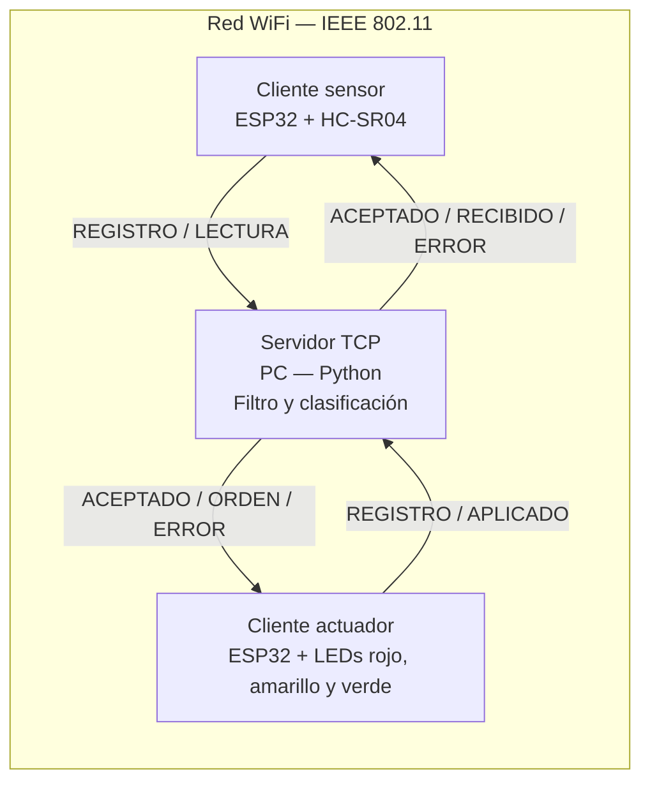

# Protocolo de aplicación — versión 1

Este documento explica quién envía cada mensaje, quién lo recibe, qué significa cada parámetro y qué respuesta se espera. **La lógica, los rangos y los plazos establecidos se conservan.**

## 1. Participantes y recorrido de la información

| Participante | Papel | Responsabilidad |
|---|---|---|
| Cliente sensor: ESP32 + HC-SR04 | Inicia una conexión TCP hacia la PC. | Medir y enviar distancias sin filtrar; recibir confirmaciones de lectura. |
| Cliente actuador: ESP32 + tres LEDs | Inicia otra conexión TCP hacia la PC. | Ejecutar órdenes y confirmar la actualización de los pines. |
| Servidor: PC con Python | Acepta ambas conexiones en el puerto 5000. | Validar, filtrar y clasificar distancias; enviar órdenes y comprobar su confirmación. |

Los dos clientes se comunican con el servidor. La decisión del color se realiza en la PC. Las flechas del diagrama representan mensajes; ambas conexiones TCP son bidireccionales.



La pila utilizada es: **protocolo de aplicación → TCP → IP → WiFi**. No se necesita acceso a Internet para ejecutar el sistema.

## 2. Cómo se escribe un mensaje

Cada mensaje es una línea de texto ASCII terminada en salto de línea:

```text
COMANDO parametro=valor, parametro=valor\n
```

| Regla | Significado |
|---|---|
| Terminación | Se envía LF (`\n`); se acepta LF o CRLF (`\r\n`). El salto real termina el mensaje: no se escriben literalmente barra y letra n. |
| Tamaño | Máximo 128 bytes contando el terminador. |
| Separación | Un espacio entre comando y argumentos; se emite coma y espacio entre parámetros. Se acepta coma con o sin un espacio posterior. |
| Nombres | Comandos en mayúsculas y parámetros en minúsculas; se distinguen mayúsculas y minúsculas. |
| Parámetros | Todos los indicados son obligatorios, aparecen una sola vez y pueden ir en cualquier orden. No se permiten parámetros adicionales. |
| Números | Enteros sin signo de hasta 4294967295; secuencias desde 1. Distancias entre 0 y 400, con punto decimal, sin signos ni notación exponencial. |
| Recepción TCP | Una lectura del socket puede contener parte de una línea o varias líneas. Se reconstruyen y separan las líneas antes de interpretarlas. |

## 3. Resumen de mensajes y permisos

| Mensaje | Quién puede enviarlo | Quién lo recibe | Respuesta esperada |
|---|---|---|---|
| REGISTRO | Sensor o actuador recién conectado. | Servidor. | ACEPTADO REGISTRO; ERROR si el registro es inválido. |
| ACEPTADO REGISTRO | Servidor. | El cliente que se registró. | Ninguna confirmación adicional. |
| LECTURA | Sensor registrado. | Servidor. | RECIBIDO con el mismo número; ERROR si es inválida. |
| RECIBIDO | Servidor. | Sensor. | Ninguna. Confirma lectura, no actuación. |
| ORDEN | Servidor. | Actuador registrado. | APLICADO con el mismo número, en menos de 1 s. |
| APLICADO | Actuador registrado. | Servidor. | Ninguna confirmación adicional. Puede seguir una nueva ORDEN. |
| ERROR | Cualquier participante, según la especificación. | El otro extremo de su conexión. | Ninguna; termina la sesión. La implementación actual lo emite en el servidor; los ESP32 cierran directamente ante errores locales. |

## 4. Detalle de cada mensaje

### 4.1 REGISTRO: identificar al cliente

**Envía:** sensor o actuador. **Recibe:** servidor. Debe ser el primer mensaje, dentro de 3 s desde la conexión.

```text
REGISTRO tipo=sensor, version=1
REGISTRO tipo=actuador, version=1
```

| Parámetro | Valores | Para qué sirve |
|---|---|---|
| tipo | `sensor` o `actuador`. | Asignar el papel del cliente y sus permisos. |
| version | Entero `1`. | Comprobar que el cliente usa esta versión del protocolo. |

**Respuesta correcta:** `ACEPTADO REGISTRO`. Un registro incorrecto recibe `ERROR codigo=...` y se cierra. Un nuevo cliente del mismo tipo reemplaza la sesión anterior. No se puede registrar dos veces la misma conexión.

### 4.2 ACEPTADO REGISTRO: habilitar el intercambio

**Envía:** servidor. **Recibe:** cliente que envió REGISTRO.

```text
ACEPTADO REGISTRO
```

**Parámetros:** ninguno; `REGISTRO` es una palabra fija, no un valor configurable. **Respuesta:** ninguna. El sensor ya puede enviar lecturas. Al actuador se le envía el estado vigente, inicialmente APAGADO.

### 4.3 LECTURA: enviar una adquisición

**Envía:** únicamente sensor registrado. **Recibe:** servidor.

```text
LECTURA numero=42, tiempo_ms=12500, distancia_cm=15.20
LECTURA numero=43, tiempo_ms=12600, distancia_cm=SIN_ECO
```

| Parámetro | Tipo y valores | Significado |
|---|---|---|
| numero | Entero de 1 a 4294967295, creciente por sesión. | Identifica la lectura y permite asociar su confirmación. |
| tiempo_ms | Entero de 0 a 4294967295. | Reloj local del sensor al iniciar la adquisición, en milisegundos; puede desbordarse. |
| distancia_cm | Decimal entre 0 y 400, o `SIN_ECO`. | Distancia original en centímetros. SIN_ECO indica ausencia de eco o adquisición fuera del dominio representable. |

**Respuesta correcta:** `RECIBIDO numero=42` para la primera línea del ejemplo. El servidor valida y procesa la lectura antes de confirmar. Una distancia fuera de 2–30 cm es válida como mensaje, pero solicita apagado. `SIN_ECO` también demuestra actividad del sensor.

El sensor intenta medir cada 100 ms. Puede tener varias lecturas pendientes; las confirmaciones deben ser crecientes y no superar el último número enviado. Si hay pendientes y pasa 1 s sin confirmaciones, desconecta y vuelve a registrarse. Los relojes de la PC y el sensor no están sincronizados: no se restan para calcular el tiempo de respuesta física.

### 4.4 RECIBIDO: confirmar una lectura

**Envía:** servidor. **Recibe:** únicamente sensor.

```text
RECIBIDO numero=42
```

| Parámetro | Valores | Significado |
|---|---|---|
| numero | Número de la LECTURA confirmada. | Confirma que se validó y procesó esa adquisición. |

**Respuesta:** ninguna. No significa que el actuador haya cambiado ni debe generar otra confirmación.

### 4.5 ORDEN: solicitar el estado de los LEDs

**Envía:** servidor. **Recibe:** únicamente actuador registrado.

```text
ORDEN numero=81, estado=AMARILLO
```

| Parámetro | Valores | Significado |
|---|---|---|
| numero | Entero de 1 a 4294967295, creciente por sesión. | Identifica la orden que debe confirmar el actuador. |
| estado | `ROJO`, `AMARILLO`, `VERDE` o `APAGADO`. | Estado completo de las salidas. Se apagan los tres LEDs y después se enciende el seleccionado, si corresponde. |

**Respuesta correcta:** `APLICADO numero=81`, después de actualizar los pines y antes de 1 s desde el envío de la orden por el servidor.

Se envía una orden al registrar el actuador, al cambiar el estado y como refresco cada 1 s. Existe como máximo una orden pendiente. Mientras espera su confirmación, el servidor conserva solo el último estado deseado; un apagado sustituye los estados anteriores aún no enviados. Tras confirmar, envía ese estado si difiere del confirmado.

### 4.6 APLICADO: confirmar una actuación

**Envía:** únicamente actuador registrado. **Recibe:** servidor.

```text
APLICADO numero=81
```

| Parámetro | Valores | Significado |
|---|---|---|
| numero | Exactamente el número de la ORDEN pendiente. | Confirma que se ejecutaron las escrituras de los pines. |

**Respuesta:** ninguna confirmación adicional. El servidor libera la orden pendiente; puede enviar otra orden o esperar al siguiente refresco. Un número incorrecto, una confirmación sin orden pendiente o una confirmación tardía provoca cierre. Esta confirmación de software no demuestra que el LED emita luz.

### 4.7 ERROR: informar el rechazo

**Envía en el código actual:** servidor. **Recibe:** el cliente cuyo mensaje fue rechazado.

```text
ERROR codigo=FORMATO
```

| Parámetro | Valores | Significado |
|---|---|---|
| codigo | Uno de los códigos del apartado 7. | Motivo por el que no se puede continuar la sesión. |

**Respuesta:** ninguna; un ERROR no genera otro ERROR. El servidor intenta enviarlo y cierra la sesión; si el cliente no lee, cierra después de 0,5 s. Los fallos de transporte y los tiempos agotados se registran y cierran directamente.

## 5. Ejemplo de secuencia completa

```mermaid
sequenceDiagram
    participant SENSOR as Cliente sensor (ESP32)
    participant SERVIDOR as Servidor (PC, Python)
    participant ACTUADOR as Cliente actuador (ESP32)
    ACTUADOR->>SERVIDOR: Inicia conexión TCP
    ACTUADOR->>SERVIDOR: REGISTRO tipo=actuador, version=1
    SERVIDOR-->>ACTUADOR: ACEPTADO REGISTRO
    SERVIDOR->>ACTUADOR: ORDEN numero=1, estado=APAGADO
    ACTUADOR-->>SERVIDOR: APLICADO numero=1
    SENSOR->>SERVIDOR: Inicia conexión TCP
    SENSOR->>SERVIDOR: REGISTRO tipo=sensor, version=1
    SERVIDOR-->>SENSOR: ACEPTADO REGISTRO
    loop Tres adquisiciones válidas, separadas por 100 ms
        SENSOR->>SERVIDOR: LECTURA numero=N, tiempo_ms=T, distancia_cm=15.20
        SERVIDOR-->>SENSOR: RECIBIDO numero=N
    end
    Note over SERVIDOR: Mediana de tres lecturas: amarillo
    SERVIDOR->>ACTUADOR: ORDEN numero=2, estado=AMARILLO
    Note over ACTUADOR: Actualiza los pines
    ACTUADOR-->>SERVIDOR: APLICADO numero=2
    Note over SERVIDOR,ACTUADOR: Refrescar estado cada 1 s; solo una orden pendiente
```

`N` y `T` son marcadores explicativos: en mensajes reales se sustituyen por enteros. Los clientes pueden conectarse en cualquier orden. Si el sensor ya produjo una clasificación vigente, el actuador recibe ese estado al registrarse.

## 6. Control y fallos

| Condición | Comportamiento |
|---|---|
| 2 ≤ d ≤ 10 cm | Rojo fijo. |
| 10 < d ≤ 20 cm | Amarillo fijo. |
| 20 < d ≤ 30 cm | Verde fijo. |
| d < 2, d > 30 o SIN_ECO | Solicitar apagado y vaciar filtro. |
| Menos de tres lecturas válidas tras inicio/reconexión/error | Apagado mientras se llena el filtro. |
| Cinco segundos sin LECTURA válida en formato | Cerrar sensor, vaciar filtro y solicitar apagado. |
| Cierre TCP detectado del sensor | Lo anterior inmediatamente. |
| Un segundo sin APLICADO correspondiente | Cerrar actuador y registrar fallo. |
| Tres segundos sin ORDEN válida en el actuador | Apagado local aunque TCP parezca conectado. |
| WiFi/TCP desconectado en el actuador | Apagado local inmediato. |
| Nuevo registro de un rol ocupado | Cerrar sesión anterior y reemplazarla. |

Filtro: mediana móvil de tres lecturas **dentro de 2–30 cm**. Una distancia fuera de ese intervalo es aceptada por el protocolo, pero fuerza apagado. SIN_ECO demuestra actividad y reinicia el plazo de cinco segundos. La primera lectura tiene el mismo plazo desde el registro.

Los clientes reintentan la conectividad cada dos segundos y repiten el registro. Cada intento TCP usa una IPv4 literal y límite de 250 ms. Vaciar búferes, números y confirmaciones al desconectar. Una nueva sesión del sensor invalida los datos anteriores.

Los plazos se verifican en cada vuelta del programa, sujetos a resolución del bucle y del sistema operativo. El apagado solicitado puede esperar a una orden pendiente (hasta un segundo). El temporizador local protege ante pérdida del servidor.

## 7. Errores

| Código | Motivo |
|---|---|
| FORMATO | Sintaxis, codificación o controles incorrectos. |
| LONGITUD | Mensaje que no cabe en 128 bytes. |
| COMANDO | Comando desconocido. |
| FALTANTE | Falta campo obligatorio. |
| ARGUMENTO | Campo desconocido. |
| DUPLICADO | Campo repetido. |
| VALOR | Número o estado fuera del dominio. |
| VERSION | Versión distinta de 1. |
| SIN_REGISTRO | Mensaje antes del registro. |
| YA_REGISTRADO | Segundo registro en la misma conexión. |
| ROL | Mensaje incompatible con el rol. |
| SECUENCIA | Número de lectura repetido o decreciente. |
| CONFIRMACION | No existe orden pendiente o su número no coincide. |
| CONFIRMACION_TARDIA | Confirmación fuera del plazo. |

El servidor intenta entregar el error y luego cierra; si el cliente no lee, cierra tras 0,5 s. Errores de transporte y tiempos agotados se registran y cierran directamente. Los firmwares apagan/reconectan ante mensajes incompatibles o errores del servidor. Prototipo para red local, sin autenticación ni cifrado de aplicación.

## 8. Verificación

Consultar [pruebas automáticas](pruebas/), [guion Ncat](pruebas/verificar_ncat.py), [instrucciones](README.md) y [estado de validación](documentacion/VALIDACION.md). Una prueba propuesta no se presenta como ejecutada.

Wireshark puede usar `tcp.port == 5000`. Los intervalos entre paquetes o entre ORDEN y APLICADO no sustituyen la medición física sensor → servidor → LED.
