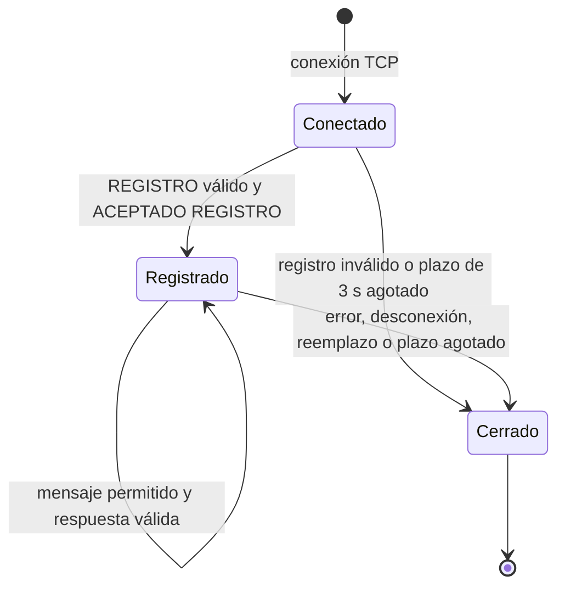
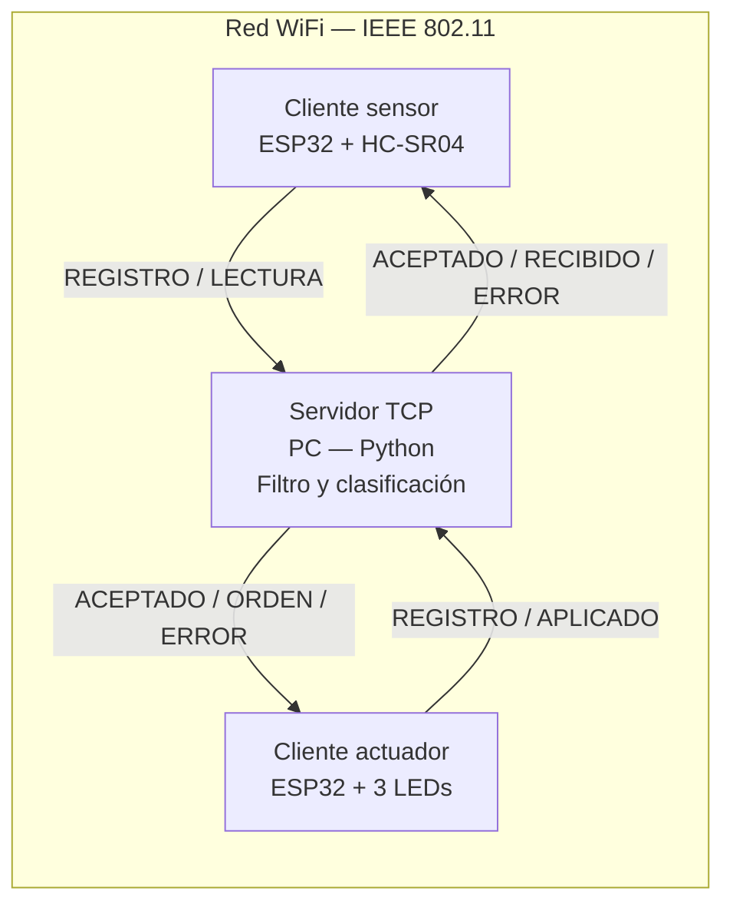

# Protocolo de aplicación — Práctica 2

Especificación del protocolo de texto entre el cliente sensor, el cliente actuador y el servidor TCP multihilo en Python. La gramática de mensajes se mantiene en la versión 1; los hilos son una decisión interna de implementación del servidor y no cambian la comunicación entre equipos.

## 1. Visión general

El sensor mide y envía distancias. El servidor valida, filtra y clasifica. El actuador recibe el color elegido y actualiza los tres LEDs.

| Elemento | Valor |
|---|---|
| Transporte | TCP sobre IP y WiFi (IEEE 802.11). |
| Servidor | PC con Python; IPv4 configurable, por ejemplo `192.168.0.102`; puerto 5000. |
| Cliente sensor | ESP32 + HC-SR04. |
| Cliente actuador | ESP32 + LEDs rojo, amarillo y verde. |
| Quién inicia las conexiones | Cada ESP32 inicia su propia conexión hacia la PC. |
| Identificación del cliente | Mediante REGISTRO, sin depender de la IP que asigne la red. |
| Versión | `version=1` en el registro. |

Ambas conexiones TCP son bidireccionales. No se necesita Internet para ejecutar el sistema.

```text
Protocolo propio: REGISTRO / LECTURA / ORDEN y sus respuestas
TCP
IP
IEEE 802.11
```

## 2. Convenciones de formato

- Codificación ASCII; cada mensaje es una línea terminada en LF (`\n`). Se acepta también CRLF (`\r\n`).
- Máximo **128 bytes**, incluido el terminador.
- Estructura: `COMANDO parametro=valor, parametro=valor`.
- Comandos en mayúsculas y parámetros en minúsculas; se distinguen mayúsculas y minúsculas.
- Un espacio entre comando y parámetros. El emisor usa coma y espacio; el receptor acepta coma con o sin un espacio posterior.
- Todos los parámetros indicados son obligatorios, aparecen una sola vez y pueden ir en cualquier orden. No se permiten parámetros adicionales.
- Los enteros no tienen signo y no superan 4294967295. Los números de lectura y orden empiezan en 1 y crecen dentro de cada sesión.
- Las distancias usan punto decimal, sin signos ni notación exponencial. El protocolo representa 0–400 cm; el control trabaja en 2–30 cm.
- TCP es un flujo de bytes: se reconstruyen líneas fragmentadas y se separan varias líneas recibidas juntas.
- Una línea malformada o excesiva provoca cierre de sesión. El servidor intenta enviar ERROR; los ESP32 cierran directamente ante errores locales.

En los ejemplos se omite el salto final para facilitar la lectura. El emisor agrega el salto real; no escribe literalmente barra y letra n.

## 3. Catálogo de comandos

### 3.1 REGISTRO

Identifica el rol. Debe ser el primer mensaje después de conectarse, dentro de tres segundos.

| Campo | Valor |
|---|---|
| Quién envía | Cliente sensor o cliente actuador recién conectado. |
| Quién recibe | Servidor. |
| Dirección | Cliente → servidor. |
| Parámetros | `tipo`, `version`. |
| Respuesta correcta | `ACEPTADO REGISTRO`. |
| Respuesta ante error | `ERROR codigo=...` y cierre. |

| Parámetro | Valores | Significado |
|---|---|---|
| tipo | `sensor` o `actuador`. | Define los mensajes permitidos para esa conexión. |
| version | `1`. | Versión implementada del protocolo. |

```text
REGISTRO tipo=sensor, version=1
REGISTRO tipo=actuador, version=1
```

Un nuevo cliente del mismo rol reemplaza la conexión anterior. Un segundo REGISTRO en la misma conexión se rechaza. Al aceptar al actuador, el servidor envía el estado vigente, inicialmente APAGADO.

### 3.2 LECTURA

Envía una adquisición sin filtrar. El sensor intenta medir cada 100 ms.

| Campo | Valor |
|---|---|
| Quién envía | Solo cliente sensor registrado. |
| Quién recibe | Servidor. |
| Dirección | Sensor → servidor. |
| Parámetros | `numero`, `tiempo_ms`, `distancia_cm`. |
| Respuesta correcta | `RECIBIDO numero=N`, con el número de la lectura. |
| Respuesta ante error | `ERROR codigo=...` y cierre. |

| Parámetro | Valores | Significado |
|---|---|---|
| numero | Entero de 1 a 4294967295, creciente por sesión. | Identifica la lectura que se confirma. |
| tiempo_ms | Entero de 0 a 4294967295. | Reloj local del sensor al comenzar la adquisición; puede desbordarse. |
| distancia_cm | Decimal de 0 a 400, o `SIN_ECO`. | Medición en cm; SIN_ECO indica ausencia de eco o adquisición fuera del dominio representable. |

```text
LECTURA numero=42, tiempo_ms=12500, distancia_cm=15.20
LECTURA numero=43, tiempo_ms=12600, distancia_cm=SIN_ECO
```

El servidor valida y procesa antes de confirmar. Una lectura fuera de 2–30 cm o SIN_ECO solicita apagado y vacía el filtro, pero cuenta como actividad del sensor si está correctamente formada.

El sensor puede tener varias lecturas pendientes. RECIBIDO debe ser creciente y no superar el último número enviado. La espera empieza al generar una lectura cuando todas las anteriores estaban confirmadas y se renueva con cada RECIBIDO válido. Si hay pendientes y la espera alcanza un segundo, el sensor desconecta y vuelve a registrarse. Una pausa sin lecturas pendientes no consume ese plazo.

### 3.3 ORDEN

Solicita un estado completo de los LEDs: se apagan los tres y se activa el color indicado, si corresponde.

| Campo | Valor |
|---|---|
| Quién envía | Servidor. |
| Quién recibe | Solo cliente actuador registrado. |
| Dirección | Servidor → actuador. |
| Parámetros | `numero`, `estado`. |
| Respuesta correcta | `APLICADO numero=N`, después de actualizar los pines. |
| Ante error local | El actuador apaga y cierra su sesión. |

| Parámetro | Valores | Significado |
|---|---|---|
| numero | Entero de 1 a 4294967295, creciente por sesión. | Identifica la orden pendiente de confirmación. |
| estado | `ROJO`, `AMARILLO`, `VERDE`, `APAGADO`. | Un color fijo o todos apagados. |

```text
ORDEN numero=81, estado=AMARILLO
```

El servidor envía órdenes al registrar al actuador, ante cambio de estado y como refresco cada segundo. Mantiene una orden vigente pendiente. Mientras espera, conserva solo el último estado deseado. Como excepción, APAGADO interrumpe un color pendiente y se encola sin esperar su APLICADO; los bytes del color que ya estén en cola o en tránsito conservan su orden TCP.

Se conserva como máximo el número de ese color interrumpido. Su APLICADO se acepta una sola vez mientras APAGADO siga pendiente y dentro del plazo de este último, sin modificar el estado confirmado ni renovar el plazo. Confirmar APAGADO elimina el número anterior; cualquier confirmación posterior de ese color se rechaza.

El plazo para procesar APLICADO es **menor de un segundo desde que el servidor encola la orden**. Incluye la espera para transmitir por TCP; no empieza al recibirla el ESP32. Una salida bloqueada tampoco mantiene la sesión indefinidamente.

## 4. Respuestas y códigos de error

Las respuestas no generan otra confirmación. Por ejemplo, RECIBIDO no se responde con RECIBIDO y APLICADO no se responde con APLICADO.

| Respuesta | Quién envía | Quién recibe | Parámetros | Significado |
|---|---|---|---|---|
| `ACEPTADO REGISTRO` | Servidor. | Cliente que se registró. | Ninguno; REGISTRO es una palabra fija. | Rol aceptado; permite comenzar el intercambio. |
| `RECIBIDO numero=42` | Servidor. | Sensor. | numero: identifica la LECTURA confirmada. | Lectura validada y procesada; no confirma actuación física. |
| `APLICADO numero=81` | Actuador. | Servidor. | numero: el de la ORDEN vigente o el color interrumpido, bajo la excepción anterior. | Se ejecutaron las escrituras de los pines; no prueba que el LED emita luz. |
| `ERROR codigo=FORMATO` | Servidor en la implementación actual; los clientes también pueden informar ERROR. | El otro extremo de su conexión. | codigo: motivo del rechazo. | La sesión termina y no se responde con otro ERROR. |

Una confirmación incorrecta, sin orden pendiente o tardía provoca cierre, salvo la excepción acotada del color interrumpido. Al rechazar al sensor, el servidor retira inmediatamente su rol, vacía el filtro y solicita APAGADO. Descarta respuestas aún en cola de la sesión rechazada e intenta enviar ERROR; un envío ya iniciado puede terminar antes. El supervisor cierra al vencer el plazo total de 0,5 s desde el inicio de la terminación, aunque el escritor no avance. La resolución depende del ciclo del supervisor (~25 ms) y del sistema operativo. Los errores de transporte y los tiempos agotados cierran directamente.

| Código del servidor | Motivo |
|---|---|
| FORMATO | Sintaxis, codificación o controles incorrectos. |
| LONGITUD | Mensaje que no cabe en 128 bytes. |
| COMANDO | Comando desconocido. |
| FALTANTE | Falta un parámetro obligatorio. |
| ARGUMENTO | Parámetro desconocido. |
| DUPLICADO | Parámetro repetido. |
| VALOR | Número o estado fuera del dominio. |
| VERSION | Versión distinta de 1. |
| SIN_REGISTRO | Mensaje antes del registro. |
| YA_REGISTRADO | Segundo registro en la misma conexión. |
| ROL | Mensaje incompatible con el rol. |
| SECUENCIA | Número de lectura repetido o decreciente. |
| CONFIRMACION | No existe orden pendiente o el número no coincide. |
| CONFIRMACION_TARDIA | Confirmación fuera del plazo. |

## 5. Gramática formal (EBNF)

La gramática describe la estructura. Los parámetros concretos, sus cantidades y valores se validan según los apartados 3 y 4.

```ebnf
mensaje       = ( aceptado | con_parametros ), fin ;
aceptado      = "ACEPTADO REGISTRO" ;
con_parametros = comando, " ", parametro, { separador, parametro } ;
comando       = "REGISTRO" | "LECTURA" | "ORDEN" | "RECIBIDO" | "APLICADO" | "ERROR" ;
parametro     = clave, "=", valor ;
clave         = ( minuscula | "_" ), { minuscula | "_" } ;
valor         = caracter_valor, { caracter_valor } ;
caracter_valor = minuscula | mayuscula | digito | "_" | "." ;
separador     = ",", [ " " ] ;
fin           = "\n" | "\r\n" ;
minuscula     = "a" | "b" | "c" | "d" | "e" | "f" | "g" | "h" | "i" | "j" | "k" | "l" | "m"
              | "n" | "o" | "p" | "q" | "r" | "s" | "t" | "u" | "v" | "w" | "x" | "y" | "z" ;
mayuscula     = "A" | "B" | "C" | "D" | "E" | "F" | "G" | "H" | "I" | "J" | "K" | "L" | "M"
              | "N" | "O" | "P" | "Q" | "R" | "S" | "T" | "U" | "V" | "W" | "X" | "Y" | "Z" ;
digito        = "0" | "1" | "2" | "3" | "4" | "5" | "6" | "7" | "8" | "9" ;
```

Ejemplo de validación semántica: `ORDEN numero=1, estado=AZUL` tiene estructura correcta, pero AZUL no es un estado permitido y el actuador cierra la sesión.

## 6. Diagrama de secuencia

```mermaid
sequenceDiagram
    participant N as Cliente sensor (ESP32)
    participant S as Servidor (PC, Python)
    participant A as Cliente actuador (ESP32)
    A->>S: Inicia conexión TCP
    A->>S: REGISTRO tipo=actuador, version=1
    S-->>A: ACEPTADO REGISTRO
    S->>A: ORDEN numero=1, estado=APAGADO
    A-->>S: APLICADO numero=1
    N->>S: Inicia conexión TCP
    N->>S: REGISTRO tipo=sensor, version=1
    S-->>N: ACEPTADO REGISTRO
    loop Tres adquisiciones válidas, separadas por 100 ms
        N->>S: LECTURA numero=N, tiempo_ms=T, distancia_cm=15.20
        S-->>N: RECIBIDO numero=N
    end
    Note over S: Mediana de tres lecturas: amarillo
    S->>A: ORDEN numero=2, estado=AMARILLO
    A-->>S: APLICADO numero=2
    Note over S,A: Refresco cada 1 s; APAGADO puede interrumpir un color pendiente
```

N y T son marcadores; se sustituyen por enteros reales. Los clientes pueden conectarse en cualquier orden. Si hay un estado calculado vigente, el actuador lo recibe al registrarse.

## 7. Estados de la conexión



Cada reconexión TCP crea una sesión nueva: se repite REGISTRO y se reinician números, búferes y confirmaciones pendientes.

| Rol registrado | Envía | Recibe |
|---|---|---|
| Sensor | LECTURA; puede informar ERROR. | RECIBIDO o ERROR. |
| Actuador | APLICADO; puede informar ERROR. | ORDEN o ERROR. |

Los ESP32 actuales cierran directamente ante un error local; no generan ERROR. Un mensaje enviado por el rol equivocado se rechaza.

## 8. Manejo de fallos

| Situación | Comportamiento |
|---|---|
| Sensor sin LECTURA durante 5 s | Cerrar sensor, vaciar filtro y solicitar APAGADO. Se cuenta desde el registro o la última LECTURA correctamente formada. |
| Sensor desconectado | Lo anterior al detectar cierre TCP o error de socket. |
| LECTURA con SIN_ECO o fuera de 2–30 cm | Confirmar recepción, vaciar filtro y solicitar APAGADO; renueva la actividad del sensor. |
| Actuador sin APLICADO válido durante 1 s | Cerrar su sesión y registrar el fallo. El segundo incluye la cola de salida de la PC. |
| Actuador sin ORDEN válida durante 3 s | Apagado local aunque TCP todavía parezca conectado. |
| WiFi/TCP desconectado en actuador | Apagado local inmediato al detectar la pérdida. |
| Actuador reconectado | Registrar de nuevo y recibir el último estado vigente; APAGADO si no hay datos válidos. |
| Rol ya ocupado | Cerrar la sesión anterior y adoptar la nueva sin que la limpieza anterior borre la nueva. |
| Pérdida de WiFi o servidor | Reintentar cada 2 s; cada intento TCP usa IPv4 literal y límite de 250 ms. |
| Registro sin aceptación durante 3 s | El ESP32 cierra e intenta reconectar. |
| Envío pendiente del ESP32 durante 1 s | Cerrar para evitar una espera indefinida. |

Los plazos se comprueban en cada vuelta del programa, sujetos a la resolución del bucle y del sistema operativo. APAGADO puede interrumpir un color pendiente sin esperar su confirmación, aunque su entrega depende de la cola y la red. El temporizador local protege ante pérdida del servidor.

## 9. Lógica de control (distancia → LEDs)

El servidor aplica la mediana móvil de tres lecturas válidas consecutivas dentro de 2–30 cm. Una lectura fuera de ese intervalo o SIN_ECO borra el filtro y apaga; se requieren tres lecturas válidas nuevas para reanudar la indicación.

| Distancia filtrada d (cm) | Rango | ORDEN para el actuador |
|---|---|---|
| 2 ≤ d ≤ 10 | Rojo | `estado=ROJO`: rojo fijo, otros apagados. |
| 10 < d ≤ 20 | Amarillo | `estado=AMARILLO`: amarillo fijo, otros apagados. |
| 20 < d ≤ 30 | Verde | `estado=VERDE`: verde fijo, otros apagados. |
| Fuera de 2–30 o SIN_ECO | Inválida para control | `estado=APAGADO`: todos apagados. |

Los tres rangos son contiguos y no se solapan dentro del rango de trabajo. Los límites 10, 20 y 30 pertenecen a rojo, amarillo y verde, respectivamente. Cada orden representa el estado completo; no hay parpadeo en la implementación actual.

## 10. Ejemplos y pruebas con Ncat y Wireshark

### 10.1 Traza de ejemplo

Clientes ya registrados y orden inicial APAGADO confirmada:

```text
sensor   → servidor : LECTURA numero=1, tiempo_ms=0, distancia_cm=15.20
servidor → sensor   : RECIBIDO numero=1
sensor   → servidor : LECTURA numero=2, tiempo_ms=100, distancia_cm=15.20
servidor → sensor   : RECIBIDO numero=2
sensor   → servidor : LECTURA numero=3, tiempo_ms=200, distancia_cm=15.20
servidor → sensor   : RECIBIDO numero=3
servidor → actuador : ORDEN numero=2, estado=AMARILLO
actuador → servidor : APLICADO numero=2
sensor   → servidor : LECTURA numero=4, tiempo_ms=300, distancia_cm=SIN_ECO
servidor → sensor   : RECIBIDO numero=4
servidor → actuador : ORDEN numero=3, estado=APAGADO
actuador → servidor : APLICADO numero=3
```

### 10.2 Casos de error

```text
LECTURA numero=1, tiempo_ms=0, distancia_cm=15.20  (sin registro)
→ ERROR codigo=SIN_REGISTRO
REGISTRO tipo=robot, version=1
→ ERROR codigo=VALOR
LECTURA numero=1, tiempo_ms=0, distancia_cm=401   (sensor registrado)
→ ERROR codigo=VALOR
```

Cada caso requiere una conexión nueva si la anterior fue cerrada por un error.

### 10.3 Pruebas sin hardware

Desde la raíz del repositorio:

```powershell
python -B -m unittest discover -s pruebas -p "test_*.py" -v
```

Las pruebas de integración usan sockets TCP reales en localhost para representar ambos clientes. Comprueban registro, estados, confirmaciones, apagado y reconexión. Ver [validación y evidencias](documentacion/VALIDACION.md).

Opcionalmente, para inspeccionar una conexión manual de sensor hacia un servidor iniciado se puede usar Ncat:

```powershell
ncat -C 192.168.0.102 5000
```

Enviar REGISTRO primero y después las tres lecturas del ejemplo, antes de que venza el plazo de inactividad. La escritura manual no sirve para evaluar el plazo de un segundo del actuador; esa comprobación pertenece a las pruebas automáticas. Ncat y Wireshark son herramientas opcionales, no requisitos de la consigna.

### 10.4 Captura en Wireshark

- Filtro: `tcp.port == 5000`.
- Consultar el flujo TCP para ver los mensajes reconstruidos.
- El intervalo observado entre mensajes mide comunicación, no demuestra por sí solo el tiempo físico sensor → servidor → LED.
- Los relojes de la PC y del sensor no están sincronizados; no restar sus tiempos para calcular respuesta física.

## 11. Diagrama de arquitectura (despliegue lógico)



Las flechas representan mensajes de aplicación. Ambos ESP32 inician sus conexiones hacia Python; las IP no identifican el rol.

## 12. Casos límite y reglas operativas

- 1,99 cm → apagado; 2 y 10 → rojo; 10,01 y 20 → amarillo; 20,01 y 30 → verde; 30,01 → apagado. La clasificación se aplica a la distancia filtrada.
- SIN_ECO no equivale a sensor inactivo: se confirma, solicita apagado y renueva el plazo de cinco segundos.
- RECIBIDO confirma procesamiento de una lectura; APLICADO confirma escrituras de GPIO. Ninguno acredita por sí solo el resultado físico.
- Hay una ORDEN vigente pendiente por sesión; APAGADO puede interrumpir un color y se conserva como máximo el identificador anterior durante el plazo de APAGADO. Las demás clasificaciones solo actualizan el estado deseado.
- Una reconexión reinicia la secuencia. El sensor reconecta antes de superar el máximo de su número de lectura.
- Los HC-SR04 no miden con fiabilidad cerca de cero; admitir 0–400 en el protocolo no declara exactitud física en todo ese intervalo.
- `MENSAJE_ENCOLADO` registra texto guardado para transmitir, no una entrega completada. `latencia_confirmacion_ms` mide desde ORDEN encolada hasta APLICADO procesado, incluyendo la cola y la red; no es respuesta física completa.

## 13. Plan de validación

| Prueba | Procedimiento | Resultado esperado | Estado/evidencia |
|---|---|---|---|
| Rangos y filtro | Fronteras 2, 10, 20 y 30 cm; tres muestras y lecturas inválidas. | Colores y apagado según apartado 9. | Software aprobado; medición física pendiente. |
| Protocolo y transporte | Campos incorrectos, líneas fragmentadas o concatenadas, límites de tamaño y roles. | Aceptar mensajes válidos y rechazar los demás. | Python y Unity; ver VALIDACION.md. |
| Inactividad y desconexión | Partir de color activo; interrumpir lecturas o cerrar sensor. | Solicitar apagado y vaciar filtro. | TCP local con tiempos reales; WiFi físico pendiente. |
| Confirmaciones y recuperación | Omitir o alterar APLICADO; reconectar ambos clientes. | Cerrar al vencer el plazo, repetir registro y limpiar sesión. | Software aprobado; pruebas físicas pendientes. |
| Estabilidad | Operación continua de 15 minutos con ambas placas. | Sin bloqueos ni reinicios. | Pendiente. |
| Exactitud | Diez lecturas a 2, 5, 10, 15, 20, 25 y 30 cm frente a cinta métrica. | Error absoluto máximo de 3 cm. | Pendiente. |
| Muestreo | Contar intentos, lecturas válidas y mensajes recibidos por separado. | Al menos 2 lecturas válidas/s. | Pendiente en hardware. |
| Respuesta completa | Medir 20 cambios entre rangos con tiempo común o video. | Hasta 1 s de sensor a LED. | Pendiente. |

Consultar [VALIDACION.md](documentacion/VALIDACION.md) para los resultados y la explicación de cada prueba. Los ensayos locales no demuestran exactitud, estabilidad ni actuación física de las placas.

## 14. Diagramas adicionales exigidos por la práctica

El informe debe incluir los esquemas eléctricos de ambos objetos y un diagrama de clases extraído de la implementación real. Las conexiones y la guía de archivos están en [README.md](README.md); esos datos no sustituyen los esquemas del montaje.

Clases principales: SensorUltrasonico, IndicadorLeds y ClienteTcp en C++; ControlDistancia, ProtocoloAplicacion, ReceptorLineas, ServidorTcp, SesionCliente y RegistroPruebas en Python. Los diagramas de arquitectura y secuencia anteriores sirven de base para el informe.

## 15. Decisiones de diseño y relación con el protocolo inicial

Se mantuvo la base: TCP, texto ASCII, líneas, parámetros separados por comas, registro del rol, dos clientes que inician conexión y puerto 5000. Los nombres y algunos campos evolucionaron durante la implementación. No se presenta esa evolución como una obligación de la rúbrica.

| Antes | Ahora | Motivo |
|---|---|---|
| REGISTER / POST / SET y nombres de campos en inglés. | REGISTRO / LECTURA / ORDEN y campos en español. | Unificar el idioma solicitado. |
| OK para registro, lectura y actuación. | ACEPTADO, RECIBIDO y APLICADO; las dos últimas llevan numero. | Distinguir las respuestas y asociarlas con la lectura u orden. Es una decisión de diseño; OK también podría servir con una única petición pendiente. |
| distance=-1. | distancia_cm=SIN_ECO. | Representar explícitamente ausencia de medición; no es una exigencia de la práctica. |
| Lecturas enteras previstas en el documento inicial. | Distancias decimales. | Los borradores no coincidían: el ESP32 enviaba decimales y Python intentaba convertir con int. Se evita perder precisión. |
| Lecturas cada 500 ms en documento; 1000 ms en el borrador del sensor. | Intentos cada 100 ms. | Unificar programas y documentación y disponer de margen para el filtro y la respuesta de hasta 1 s. El valor concreto es una decisión de diseño. |
| Parpadeo previsto en servidor y documento inicial. | Tres colores fijos. | Decisión del plan vigente. El borrador del actuador solo reconocía on y no implementaba blink_2 ni blink_4. La práctica admite comportamientos distintos sin exigir parpadeo. |
| Primer rango desde 0 cm. | Rango de trabajo desde 2 cm. | Acordar el control con el rango físico declarado del sensor. |

La corrección de inactividad, reconexiones y confirmaciones era necesaria para cumplir el comportamiento definido. No obligaba a cambiar todos los nombres, añadir identificadores ni usar un modelo de servidor específico. Se conserva la implementación actual y se recupera la presentación del documento inicial.
